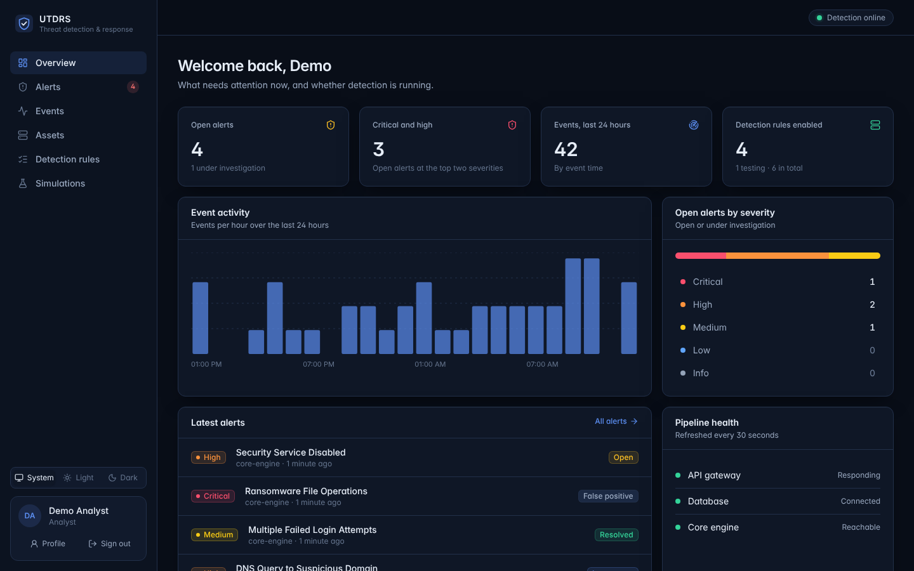
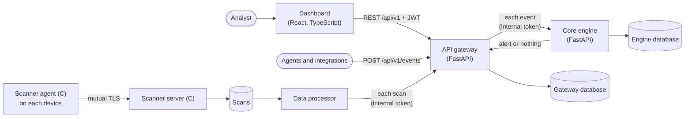
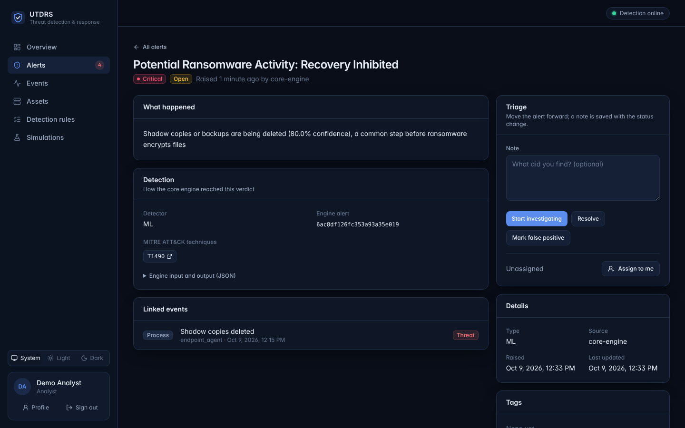

# UTDRS — Unified Threat Detection and Response System

[](https://github.com/Alex-Muhscience/UTDRS-Capstone-Project/actions/workflows/ci.yml)

Threat detection and response for small and medium-sized organisations that have no security operations team. UTDRS takes in security events, runs each one through several complementary detectors (signature rules mapped to MITRE ATT&CK, anomaly detection, correlation, threat intelligence and ML), and gives an analyst alerts they can act on, each traceable to the event and the rule or signal that raised it.

UTDRS was a **Top 5 finalist in the Mozilla Responsible Computing Challenge**.



## What works today

| Component | Path | Status |
|---|---|---|
| **Dashboard**: getting started, overview, cases, response and playbooks, connectors, detection tuning, monthly reports, email notifications, alert triage, events with the engine's verdict, assets, detection rules, simulations, and administration | [`frontend/`](frontend) | Working. React 19, TypeScript, Vite, Tailwind CSS; typed against the gateway's API schema. |
| **API gateway**: authentication, events, alerts, assets, rules, simulations, API keys, audit log; sends every event to the engine, and turns device scans into assets and events. Each organisation's data is kept apart | [`services/api-gateway/`](services/api-gateway) | Working. Python 3.12, FastAPI, MongoDB. |
| **Core engine**: six detectors, MITRE ATT&CK mapping, risk scoring | [`services/core-engine/`](services/core-engine) | Working. The ML detector classifies emails and network flows with trained models, and uses hand-written indicators for everything else. |
| **MCP server**: AI assistants (Claude and other MCP clients) investigate and act through UTDRS's API with an API key | [`services/mcp-server/`](services/mcp-server) | Working. Python 3.12, the official MCP SDK; Streamable HTTP and stdio. |
| **Data processor**: batch worker that delivers the scanner's scans to the gateway, with retries and a dead-letter collection | [`services/data-processor/`](services/data-processor) | Working. Python 3.12, PyMongo. |
| **Device scanner**: inventory agent and collection server over mutual TLS | [`scanner/`](scanner) | Working on Linux. C, OpenSSL. Windows code paths are not built or tested in CI. |
| **Research models**: the original capstone's models, and the scripts that train the versions the engine runs | [`research/capstone/models/`](research/capstone/models) | Both models are retrained from public datasets (phishing emails; UNSW-NB15 network flows) because the originals' preprocessing was not kept. |

Each component has its own README with setup, configuration and tests. [`docs/architecture.md`](docs/architecture.md) describes how they fit together: data ownership, request flows, trust boundaries and failure handling.

## How it fits together



1. An event reaches the gateway (from an agent, an integration, or the dashboard's *Send test event*). The gateway stores it and answers at once.
2. In the background, the gateway sends the event to the core engine, which runs its detectors concurrently and returns the most specific verdict: an alert, or nothing.
3. A threat becomes an alert in the gateway, linked to the event and carrying the detector, the MITRE ATT&CK techniques and the engine's details. The verdict (threat, clean, or error) is recorded on the event either way.
4. In the dashboard, analysts triage alerts: investigate, assign, add notes, resolve or mark false positives.

Devices report themselves through the scanner. An agent on each device sends its inventory (host name, operating system, hardware, network interfaces) to the scanner server, which stores it; the data processor delivers each stored scan to the gateway. There the device becomes an asset, kept up to date by later scans, and a device seen for the first time, or one whose inventory has changed, raises an event that follows steps 2 to 4 like any other.

Each service owns its database. The gateway and the engine store differently shaped events and alerts, so they must never share one.



## Quick start

With Docker, the whole system runs with one command. You need Docker with Compose v2.20 or later; no Python, Node.js or MongoDB.

```bash
git clone https://github.com/Alex-Muhscience/UTDRS-Capstone-Project.git utdrs && cd utdrs
cp .env.example .env     # then set JWT_SECRET and INTERNAL_API_TOKEN to long random values, and ADMIN_PASSWORD
docker compose up -d --build --wait
docker compose run --rm seed     # optional: demo data
```

Open http://localhost:8080 and sign in as `admin` with your `ADMIN_PASSWORD`, or register an analyst account. Then try **Events → Send test event**. The gateway's API documentation is at http://localhost:8000/api/v1/docs.

**[The Docker guide](docs/docker.md)** covers everything else: configuration, everyday commands, the optional data processor and scanner, backups, developing and testing against the containers, troubleshooting, and what to change before running it for real users.

### Without Docker

You need Python 3.12, Node.js 22.22 or later (24 recommended) and a MongoDB, for example `docker run -d -p 27017:27017 mongo:7`. Install each Python service's dependencies in its own environment:

```bash
python3.12 -m venv .venv-gateway && .venv-gateway/bin/pip install -r services/api-gateway/requirements.txt
python3.12 -m venv .venv-engine  && .venv-engine/bin/pip install -r services/core-engine/requirements.txt
```

Start the gateway and the core engine, connected to each other with a shared secret and each with its own database. The script leaves them running until you press Ctrl-C:

```bash
export ADMIN_USERNAME=admin ADMIN_PASSWORD='choose-a-strong-password'
DB_NAME=utdrs GATEWAY_PYTHON=.venv-gateway/bin/python ENGINE_PYTHON=.venv-engine/bin/python \
  scripts/run-stack.sh
```

In another terminal (with the same `ADMIN_USERNAME` and `ADMIN_PASSWORD`), add demo data and start the dashboard's dev server:

```bash
python3 scripts/seed-demo.py
cd frontend && npm install && npm run dev
```

Open http://localhost:5173.

## Development

| What | How |
|---|---|
| Gateway tests (46) | `cd services/api-gateway && MONGODB_URI=mongodb://localhost:27017 python -m pytest` |
| Engine tests (26) | `cd services/core-engine && MONGODB_URI=mongodb://localhost:27017 python -m pytest` |
| Dashboard checks and tests (34) | `cd frontend && npm run lint && npm run typecheck && npm test` |
| System test: gateway and engine as separate services | `GATEWAY_PYTHON=… ENGINE_PYTHON=… scripts/system-test.sh` |
| End-to-end: the dashboard in Chromium against the real stack | `GATEWAY_PYTHON=… ENGINE_PYTHON=… scripts/run-stack.sh npm --prefix frontend run test:e2e` |
| Scanner | `cd scanner && make` |

Tests that need MongoDB run only when `MONGODB_URI` is set and use throwaway databases. [`scripts/run-stack.sh`](scripts/run-stack.sh) starts the gateway and the engine, optionally runs a command against them, and cleans up; without `DB_NAME` it creates throwaway databases and drops them afterwards.

The dashboard's TypeScript types are generated from the gateway's OpenAPI schema. After changing the gateway's API, run `python services/api-gateway/scripts/export_openapi.py` and `npm run gen:api` in `frontend/`, and commit both files.

### Continuous integration

Every pull request runs:

- the gateway's and the engine's tests against MongoDB
- the system test
- the dashboard's lint, typecheck, unit tests, build and `npm audit`
- the API contract check (the committed schema and types match the gateway)
- the end-to-end tests in Chromium
- the Linux build of the scanner
- checks on the data processor
- the whole stack under Docker Compose (every image built, the stack seeded, each service checked and the end-to-end tests run against the containers)

## Roadmap

The plan for turning UTDRS into a commercial product, with every requirement and every gap in today's code, is in [docs/enterprise-plan.md](docs/enterprise-plan.md). The near-term list:

Done:

- [x] Bring the components into one repository with their history, removing committed credentials, vendored tools and binaries
- [x] Python 3.12 and current FastAPI, Pydantic and PyMongo; tests and CI for every component (a pull request runs the jobs for the parts it changes; everything runs weekly and on demand)
- [x] Connect the gateway to the core engine: event in, detection, alert out
- [x] Rebuild the dashboard on the gateway's real API, typed against its schema, with unit and end-to-end tests
- [x] Give the engine its own database and load its signature rules; fix rules that flagged all DNS and network traffic
- [x] Make the scanner's collection server start and run safely, and verify the server's name on the agent
- [x] One-command local stack (`docker compose up`) with seeded demo data
- [x] Roles enforced (administrators and analysts), user administration in the dashboard, and the first administrator created from settings
- [x] Connect the scanner: one wire format between the agent and the server, and scans delivered through the data processor to the gateway as assets and events

Next:

- [ ] Push new alerts to the dashboard as they happen, instead of polling every 15 seconds
- [x] Trained, evaluated models for phishing emails and network flows in the core engine
- [x] Throttle sign-in by account and address, using the client address behind trusted proxies
- [x] Rules edited in the dashboard run in the core engine, with malformed logic refused and unsupported logic marked
- [x] API keys with scopes for agents and integrations, and a tamper-evident audit log of sign-ins and changes
- [x] Multi-tenancy: each organisation's data kept apart in the gateway and the engine, enforced in one place, with organisation sign-up
- [x] Cases: related alerts grouped by user, device, address or sender, with owners, deadlines, timelines, notes, evidence and a plain-language explanation
- [x] Response actions and playbooks: approval, automatic and notify modes, undo, safety limits and built-in playbooks (Microsoft 365 actions run once its connector is connected)
- [x] Email notifications: new cases, approvals needed and actions taken, per-person preferences, retried delivery and a delivery log
- [x] Data retention: per-organisation periods for each kind of data, deleted hourly, never open work
- [x] MCP server: AI assistants investigate cases and alerts, give verdicts and propose response actions through UTDRS, with an API key's permissions and audit trail
- [x] Webhooks: signed events for alerts, cases, response actions, reports and connectors, retried for a day, with a delivery log
- [x] Multi-factor authentication: authenticator codes and recovery codes, enforceable per organisation
- [x] Onboarding: a checklist from sign-up to first results the same day, worked out from the organisation's state
- [x] Microsoft 365 connector: admin consent or an own app registration, encrypted secrets, Entra ID sign-ins and audit logs, Exchange mailbox audit, Defender alerts and phishing checks of the emails they name, built-in identity, mailbox and email detections, and response actions through it (built against Graph's documented formats; not yet run against a live tenant)
- [x] Identity correlations in the engine: impossible travel, password spraying, password guessing, success after repeated failures and MFA fatigue
- [x] Detection tuning: analysts' verdicts, suppressions and allow-lists with safety limits, noisy-detector reporting, and labels exported for retraining
- [x] Monthly executive report: figures against the month before, threats, actions, what is still open and what to do next; on the web and as a PDF, made and emailed on the 1st
- [ ] Trained models for the remaining indicator-based ML detectors (malware, user behaviour)
- [ ] Public demo deployment

## Security

- Never commit credentials, `.env` files or key material. The root `.gitignore` blocks the common cases; each service has a `.env.example` to copy.
- The core engine is an internal service: only the gateway should reach it, with `INTERNAL_API_TOKEN` set on both.
- The scanner's TLS certificates are generated per deployment (see [`scanner/`](scanner)).
- Report a vulnerability privately to the maintainer rather than in a public issue.

## Repository history

This repository started as the UTDRS capstone project. The other components were developed in their own repositories and merged in with their full commit history: `utdrs-core-engine`, `utdrs-api-gateway`, `UTDRS-Data-Processor`, `UTDRS-frontend` and `UTDRS-Device-Scanner`. While merging, committed credentials and key material were removed from the imported history, along with vendored build tools and compiled binaries. The dashboard was later rebuilt from scratch on the gateway's API.

## Licence

No open-source licence has been chosen yet, so all rights are reserved for now. The API gateway carries its original copyright notice in [`services/api-gateway/COPYRIGHT`](services/api-gateway/COPYRIGHT).

## Deploying

See [docs/deploy-render.md](docs/deploy-render.md).
