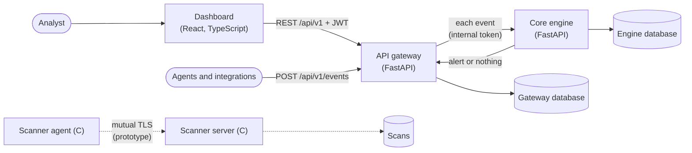

# UTDRS — Unified Threat Detection and Response System

[](https://github.com/Alex-Muhscience/UTDRS-Capstone-Project/actions/workflows/ci.yml)

Threat detection and response for small and medium-sized organisations that have no security operations team. UTDRS takes in security events, runs each one through several complementary detectors (signature rules mapped to MITRE ATT&CK, anomaly detection, correlation, threat intelligence and ML), and gives an analyst alerts they can act on, each traceable to the event and the rule or signal that raised it.

UTDRS was a **Top 5 finalist in the Mozilla Responsible Computing Challenge**.


## What works today

| Component | Path | Status |
|---|---|---|
| **Dashboard**: overview, alert triage, events with the engine's verdict, assets, detection rules, simulations | [`frontend/`](frontend) | Working. React 19, TypeScript, Vite, Tailwind CSS; typed against the gateway's API schema. |
| **API gateway**: authentication, events, alerts, assets, rules, simulations; sends every event to the engine | [`services/api-gateway/`](services/api-gateway) | Working. Python 3.12, FastAPI, MongoDB. |
| **Core engine**: six detectors, MITRE ATT&CK mapping, risk scoring | [`services/core-engine/`](services/core-engine) | Working. The ML detector uses hand-written indicators for now. |
| **Data processor**: batch worker with retries and a dead-letter collection | [`services/data-processor/`](services/data-processor) | Works on its own; not yet fed by the rest of the system. |
| **Device scanner**: inventory agent and collection server over mutual TLS | [`scanner/`](scanner) | Prototype. The server runs; the agent and server do not share a wire format yet. |
| **Research prototype**: the original capstone, its models and report | [`research/capstone/`](research/capstone) | Archived for reference. |

Each component has its own README with setup, configuration and tests. [`docs/architecture.md`](docs/architecture.md) describes how they fit together: data ownership, request flows, trust boundaries and failure handling.

## How it fits together



1. An event reaches the gateway (from an agent, an integration, or the dashboard's *Send test event*). The gateway stores it and answers at once.
2. In the background, the gateway sends the event to the core engine, which runs its detectors concurrently and returns the most specific verdict: an alert, or nothing.
3. A threat becomes an alert in the gateway, linked to the event and carrying the detector, the MITRE ATT&CK techniques and the engine's details. The verdict (threat, clean, or error) is recorded on the event either way.
4. In the dashboard, analysts triage alerts: investigate, assign, add notes, resolve or mark false positives.

Each service owns its database. The gateway and the engine store differently shaped events and alerts, so they must never share one.


## Quick start

You need Python 3.12, Node.js 22.22 or later (24 recommended) and MongoDB. For MongoDB, Docker is the quickest:

```bash
docker run -d --name utdrs-mongo -p 27017:27017 mongo:7
```

Install each Python service's dependencies in its own environment:

```bash
python3.12 -m venv .venv-gateway && .venv-gateway/bin/pip install -r services/api-gateway/requirements.txt
python3.12 -m venv .venv-engine  && .venv-engine/bin/pip install -r services/core-engine/requirements.txt
```

Start the gateway and the core engine, connected to each other with a shared secret and each with its own database. The script leaves them running until you press Ctrl-C:

```bash
DB_NAME=utdrs GATEWAY_PYTHON=.venv-gateway/bin/python ENGINE_PYTHON=.venv-engine/bin/python \
  scripts/run-stack.sh
```

In another terminal, fill it with a day of demo activity (the alerts are real verdicts from the engine), then start the dashboard:

```bash
python3 scripts/seed-demo.py          # prints the demo account's password
cd frontend && npm install && npm run dev
```

Open http://localhost:5173 and sign in as `demo`, or register an account. The gateway's interactive API documentation is at http://localhost:8000/api/v1/docs.

## Development

| What | How |
|---|---|
| Gateway tests (36) | `cd services/api-gateway && MONGODB_URI=mongodb://localhost:27017 python -m pytest` |
| Engine tests (26) | `cd services/core-engine && MONGODB_URI=mongodb://localhost:27017 python -m pytest` |
| Dashboard checks and tests (25) | `cd frontend && npm run lint && npm run typecheck && npm test` |
| System test: gateway and engine as separate services | `GATEWAY_PYTHON=… ENGINE_PYTHON=… scripts/system-test.sh` |
| End-to-end: the dashboard in Chromium against the real stack | `GATEWAY_PYTHON=… ENGINE_PYTHON=… scripts/run-stack.sh npm --prefix frontend run test:e2e` |
| Scanner | `cd scanner && make` |

Tests that need MongoDB run only when `MONGODB_URI` is set and use throwaway databases. [`scripts/run-stack.sh`](scripts/run-stack.sh) starts the gateway and the engine, optionally runs a command against them, and cleans up; without `DB_NAME` it creates throwaway databases and drops them afterwards.

The dashboard's TypeScript types are generated from the gateway's OpenAPI schema. After changing the gateway's API, run `python services/api-gateway/scripts/export_openapi.py` and `npm run gen:api` in `frontend/`, and commit both files.

### Continuous integration

Every pull request runs:

- the gateway's and the engine's tests against MongoDB
- the system test
- the dashboard's lint, typecheck, unit tests, build and `npm audit`
- the API contract check (the committed schema and types match the gateway)
- the end-to-end tests in Chromium
- the Linux build of the scanner
- checks on the data processor
- Docker builds of the gateway, engine, dashboard and scanner server

## Roadmap

Done:

- [x] Bring the components into one repository with their history, removing committed credentials, vendored tools and binaries
- [x] Python 3.12 and current FastAPI, Pydantic and PyMongo; tests and CI for every component
- [x] Connect the gateway to the core engine: event in, detection, alert out
- [x] Rebuild the dashboard on the gateway's real API, typed against its schema, with unit and end-to-end tests
- [x] Give the engine its own database and load its signature rules; fix rules that flagged all DNS and network traffic
- [x] Make the scanner's collection server start and run safely, and verify the server's name on the agent

Next:

- [ ] Scanner: one wire format (the agent sends JSON `SCAN` commands with a checksum over the other fields), and scans delivered to the gateway as assets and events
- [ ] Push new alerts to the dashboard as they happen, instead of polling every 15 seconds
- [ ] Send rules edited in the dashboard to the engine (the gateway's rule catalogue and the engine's rules are separate today)
- [ ] Enforce roles on administrative routes, and rate-limit sign-in using the client address from the proxy
- [ ] Replace the indicator-based ML detectors with trained, evaluated models
- [ ] One-command local stack (`docker compose up`) with seeded demo data
- [ ] Public demo deployment

## Security

- Never commit credentials, `.env` files or key material. The root `.gitignore` blocks the common cases; each service has a `.env.example` to copy.
- The core engine is an internal service: only the gateway should reach it, with `INTERNAL_API_TOKEN` set on both.
- The scanner's TLS certificates are generated per deployment (see [`scanner/`](scanner)).
- Report a vulnerability privately to the maintainer rather than in a public issue.

## Repository history

This repository started as the UTDRS capstone project. The other components were developed in their own repositories and merged in with their full commit history: `utdrs-core-engine`, `utdrs-api-gateway`, `UTDRS-Data-Processor`, `UTDRS-frontend` and `UTDRS-Device-Scanner`. While merging, committed credentials and key material were removed from the imported history, along with vendored build tools and compiled binaries. The dashboard was later rebuilt from scratch on the gateway's API.

## Licence

No open-source licence has been chosen yet, so all rights are reserved for now. The API gateway carries its original copyright notice in [`services/api-gateway/COPYRIGHT`](services/api-gateway/COPYRIGHT).
