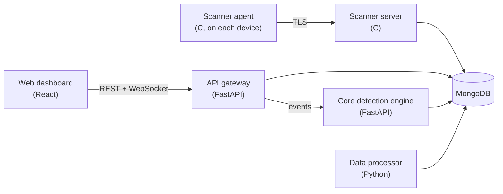

# UTDRS — Unified Threat Detection and Response System

A threat detection and response platform for small and medium-sized organisations that have no security operations team: collect security events from devices, detect threats with several complementary methods, and give an operator alerts they can act on, with the AI components kept explainable.

UTDRS was a **Top 5 finalist in the Mozilla Responsible Computing Challenge**.

> **Status:** this repository brings together components that were developed in separate repositories. They are being integrated into one working system; see [Roadmap](#roadmap) for what is done and what is in progress.

## How it fits together

| Path | Component | Stack |
|---|---|---|
| [`frontend/`](frontend) | Web dashboard: user portal and admin console | React, Vite, Tailwind CSS |
| [`services/api-gateway/`](services/api-gateway) | Public API: authentication, RBAC, alerts, events, assets, detection rules, simulations | Python, FastAPI, MongoDB |
| [`services/core-engine/`](services/core-engine) | Detection: signature rules mapped to MITRE ATT&CK, anomaly detection, correlation, YARA, threat-intelligence enrichment, risk scoring | Python, FastAPI, scikit-learn |
| [`services/data-processor/`](services/data-processor) | Batch processing of stored events with retries and a dead-letter collection | Python, MongoDB |
| [`scanner/`](scanner) | Device scanner agent and collection server with mutual TLS | C, OpenSSL, mongo-c-driver |
| [`research/capstone/`](research/capstone) | The original capstone prototype, trained models and project report | Python, TensorFlow/Keras, React |

Each component has its own README with setup instructions.

## Roadmap

- [x] Bring the components into one repository, keeping their history
- [ ] Upgrade the Python services to a supported Python and current FastAPI/Pydantic; tests and CI for every component
- [ ] Connect the gateway to the core engine: event in, detection, alert out, pushed live to the dashboard
- [ ] Point the dashboard at the gateway's real API and remove features that have no backend
- [ ] Replace the simulated machine-learning detectors with evaluated models
- [ ] One-command local stack (`docker compose up`) with seeded demo data and an attack simulator
- [ ] Public demo deployment

## Repository history

This repository started as the UTDRS capstone project. The other components were developed in their own repositories and merged in with their full commit history:
`utdrs-core-engine`, `utdrs-api-gateway`, `UTDRS-Data-Processor`, `UTDRS-frontend` and `UTDRS-Device-Scanner`. While merging, credentials and key material that had been committed were removed from the imported history, along with vendored build tools and compiled binaries.

## Security

Never commit credentials, `.env` files or key material; the root `.gitignore` blocks the common cases. The scanner's TLS certificates are generated per deployment with the scripts in [`scanner/scripts/`](scanner/scripts).
