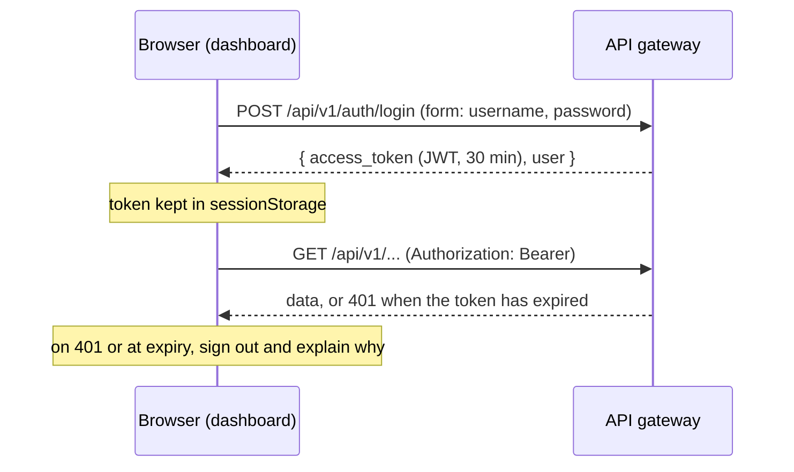

# UTDRS architecture

How the parts of UTDRS fit together: what each service owns, how requests flow, where the trust boundaries are, and what happens when something fails. For setup and configuration, see each component's README.

## Services

| Service | Role | Listens on | Talks to |
|---|---|---|---|
| Dashboard (`frontend/`) | The analyst's interface; a static single-page app | 5173 (dev), 4173 (preview), 8080 (Docker, nginx) | The gateway only, through `/api` |
| API gateway (`services/api-gateway/`) | Public API: users, events, alerts, assets, rules, simulations | 8000 | MongoDB (its own database), the core engine |
| Core engine (`services/core-engine/`) | Detection: turns an event into an alert or nothing | 8001 locally (8000 in its container) | MongoDB (its own database), threat-intelligence APIs when enabled |
| Data processor (`services/data-processor/`) | Batch worker between two collections | 5000 (health) | MongoDB |
| Scanner server (`scanner/`) | Receives device inventories from agents | 8443 (TLS) | MongoDB |
| Scanner agent (`scanner/`) | Collects a device's inventory | | The scanner server |

## Data ownership

Each service owns its data and no service reads another's database. The gateway and the engine both have collections named `events`, `alerts` and `detection_rules`, with different document shapes. Sharing one database makes the gateway's lists fail validation, and makes the engine's signature detector read the gateway's rule catalogue instead of its own rules. A system test fails if this happens.

| Database (default name) | Owner | Collections |
|---|---|---|
| `utdrs` | API gateway | `users`, `events`, `alerts`, `assets`, `detection_rules` (the catalogue shown in the dashboard), `simulations` |
| `utdrs_engine` | Core engine | `events` (every event it analyses, the history for correlation and anomaly baselines), `alerts` (its own verdicts), `detection_rules` (signature rules it runs) |
| `utdrs_db` | Scanner server | `scans` |
| *(named in its URI)* | Data processor | `raw_data`, `processed_data`, `failed_data` |

## Request flows

### Signing in



### An event, from ingestion to triage

```mermaid
sequenceDiagram
  participant S as Source
  participant G as API gateway
  participant E as Core engine
  participant D as Dashboard
  S->>G: POST /api/v1/events/
  G-->>S: 201, the stored event
  G->>E: POST /detections/process (X-Internal-Token), in the background
  par detectors run concurrently
    E->>E: signature, YARA, correlation, threat intel, ML, anomaly
  end
  E-->>G: the most specific verdict as an alert, or null
  G->>G: create an alert linked to the event; record metadata.analysis on the event
  D->>G: polls every 15 s (alerts, summary, events)
  D->>G: PATCH /alerts/{id}/status (in_progress, resolved, …) with a note
```

The engine's verdict priority, from the most specific evidence to the least, is signature, YARA, correlation, threat intelligence, ML, anomaly. One event produces at most one alert.

## Trust boundaries

| Boundary | Protection |
|---|---|
| Browser → dashboard | Static files only. In the Docker image, nginx sends a Content-Security-Policy with no inline or third-party scripts, plus `X-Frame-Options: DENY`, `nosniff` and a strict referrer policy. |
| Browser → gateway | JWT bearer tokens (HS256, `JWT_SECRET`), bcrypt password hashes, role checks on administrative routes, CORS limited to `CORS_ORIGINS` (not needed when the dashboard proxies `/api`), Host allow-list, a 10 MB request limit, and security headers with a request ID on every response. Registration, which can be closed, always creates an analyst; a deactivated account's tokens stop working at once. |
| Gateway → engine | A shared secret in `X-Internal-Token`, compared in constant time. The engine should only be reachable from the gateway's network. |
| Agent → scanner server | Mutual TLS: the server requires a client certificate from the CA, and the agent verifies the server's certificate chain and name. |
| Services → MongoDB | Connection strings from the environment; never committed. |

Roles: administrators manage users, detection rules and simulations; analysts triage alerts and work with events and assets; everyone signed in can read everything. Known gaps, on the [roadmap](../README.md#roadmap): sign-in is not rate limited, devices and integrations need a user's token, and the dashboard polls rather than receiving pushed updates.

## When something fails

| Failure | Effect |
|---|---|
| Core engine down or slow | Events are still stored and returned at once. The event's analysis is recorded as `error`, the dashboard shows *Analysis failed*, its status pill shows *Core engine unreachable*, and `GET /detection/` reports `degraded`. |
| No core engine configured | Events are stored without analysis (*Not analysed*), and the status is `standalone`. |
| Gateway down | The dashboard's status pill shows *Gateway unreachable* and pages show *Cannot reach the API gateway* with a retry; opening the dashboard while it is down shows *The API gateway is not responding*. |
| Token expired or revoked | The gateway answers 401, and the dashboard signs out with an explanation and returns to the same page after sign-in. |
| MongoDB down | `GET /api/v1/health/db` reports `disconnected`, and the dashboard's pipeline-health card shows it. |
| A document the data processor cannot transform | It is written to the dead-letter collection with its error, and the batch continues. |

## Testing strategy

| Level | What it proves | Where |
|---|---|---|
| Unit | Detectors and rules, formatting, sessions, the API client's error handling | `services/core-engine/tests/unit`, `services/api-gateway/tests/unit`, `frontend/src/**/*.test.ts` |
| Service | Each service against a real MongoDB, and each dashboard page against a stubbed gateway | `services/*/tests/e2e`, `services/*/tests/integration`, `frontend/src/pages/__tests__` |
| Contract | The dashboard's types match the gateway's OpenAPI schema | CI job *API contract* |
| System | The gateway and the engine as separate processes: an event becomes an alert, and the lists stay clean | `tests/system`, `scripts/system-test.sh` |
| End to end | A person in a browser: register, send an event, triage the alert the engine raised | `frontend/e2e`, CI job *Dashboard end-to-end* |
| Deployment | The Docker Compose stack builds, starts healthy, takes demo data and passes the same end-to-end tests | `docker-compose.yml`, CI job *Docker Compose stack* |
