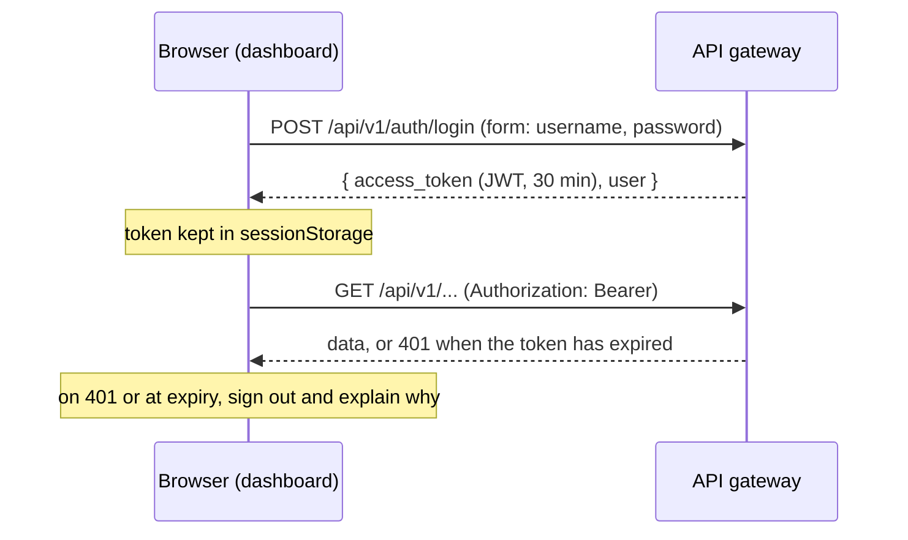
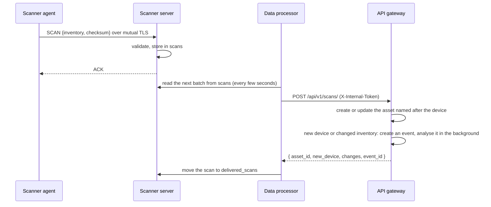

# UTDRS architecture

How the parts of UTDRS fit together: what each service owns, how requests flow, where the trust boundaries are, and what happens when something fails. For setup and configuration, see each component's README.

## Services

| Service | Role | Listens on | Talks to |
|---|---|---|---|
| Dashboard (`frontend/`) | The analyst's interface; a static single-page app | 5173 (dev), 4173 (preview), 8080 (Docker, nginx) | The gateway only, through `/api` |
| API gateway (`services/api-gateway/`) | Public API: users, events, alerts, assets, rules, simulations; takes in device scans | 8000 | MongoDB (its own database), the core engine |
| Core engine (`services/core-engine/`) | Detection: turns an event into an alert or nothing | 8001 locally (8000 in its container) | MongoDB (its own database), threat-intelligence APIs when enabled |
| Data processor (`services/data-processor/`) | Delivers the scanner server's stored scans to the gateway | 5000 (health) | MongoDB (the scanner's database), the gateway |
| Scanner server (`scanner/`) | Receives device inventories from agents | 8443 (TLS) | MongoDB (its own database) |
| Scanner agent (`scanner/`) | Collects a device's inventory | | The scanner server |

## Organisations

Each organisation (tenant) has its own users, events, alerts, assets, rules, simulations, API keys and audit log, and cannot see another's. In the gateway this is enforced in one place: authentication sets the caller's organisation, and every collection holding organisation data is reached through a wrapper that adds the organisation to every query and refuses to run without one. In the engine, each event carries its organisation, and while it is processed the detectors see only that organisation's history and alerts, and only the built-in rules plus that organisation's own. A deployment starts with one organisation; it can host many (`REGISTRATION_MODE=organisation`). See the [gateway README](../services/api-gateway/README.md#organisations).

## Data ownership

Each service owns its data and no service reads another's database, with one deliberate hand-off: the scanner's `scans` collection is a queue that the scanner server fills and the data processor drains. The gateway and the engine both have collections named `events`, `alerts` and `detection_rules`, with different document shapes. Sharing one database makes the gateway's lists fail validation, and makes the engine's signature detector read the gateway's rule catalogue instead of its own rules. A system test fails if this happens.

| Database (default name) | Owner | Collections |
|---|---|---|
| `utdrs` | API gateway | `tenants`, `platform_locks`, and per organisation: `users`, `events`, `alerts`, `assets`, `detection_rules` (the catalogue shown in the dashboard), `simulations`, `login_failures` (sign-in throttling), `gateway_state` (last rule sync), `api_keys`, `audit_log` and `audit_log_head` |
| `utdrs_engine` | Core engine | `events` (every event it analyses, the history for correlation and anomaly baselines), `alerts` (its own verdicts), `detection_rules` (the signature rules it runs: its built-in rules, and copies of the gateway's runnable rules, which the gateway replaces as a set) |
| `utdrs_db` | Scanner server and data processor | `scans` (accepted scans waiting for delivery, written by the server), `delivered_scans` (each with the gateway's answer) and `failed_scans` (scans that could not be delivered, with the error), both written by the processor |

## Request flows

### Signing in



### An event, from ingestion to triage

```mermaid
sequenceDiagram
  participant S as Source
  participant G as API gateway
  participant E as Core engine
  participant D as Dashboard
  S->>G: POST /api/v1/events/
  G-->>S: 201, the stored event
  G->>E: POST /detections/process (X-Internal-Token), in the background
  par detectors run concurrently
    E->>E: signature, YARA, correlation, threat intel, ML, anomaly
  end
  E-->>G: the most specific verdict as an alert, or null
  G->>G: create an alert linked to the event; record metadata.analysis on the event
  D->>G: polls every 15 s (alerts, summary, events)
  D->>G: PATCH /alerts/{id}/status (in_progress, resolved, …) with a note
```

### A rule, from the dashboard to the engine

The gateway's catalogue is the source of truth. After every change to a rule, and every minute as a safety net, the gateway compiles the enabled rules whose logic the engine can run and sends the whole set to `PUT /rules/managed/gateway`; the engine replaces its copies of the gateway's rules with it, leaving its built-in rules alone. Rules the engine cannot run yet stay in the catalogue, marked with the reason. An alert from one of these rules carries the gateway's rule id, and the dashboard links to the rule.

Every alert is put in a case: an open one from the last day about the same user, device, source address, sender or file, or a new one. Analysts work cases (owner, deadline from priority, timeline, notes), and closing a case closes its open alerts.

When an alert is put in a case, the gateway runs the playbooks it matches, once per case, in the background. Their actions act through connectors (Microsoft 365 through Microsoft Graph) or on UTDRS itself; each runs at once or waits for a person's approval, as the playbook's mode, the organisation's mode and the safety limits say, and each is recorded in the audit log and on the case's timeline, with an undo where one exists.

The engine's verdict priority, from the most specific evidence to the least, is signature, YARA, correlation, threat intelligence, ML, anomaly. One event produces at most one alert.

### A device scan, from the agent to an asset



A scan always refreshes its asset: operating system, address, last-seen time and the full inventory under `metadata.scanner`. It never overwrites what an analyst sets (type, criticality, owner, location). Only the first scan of a device, or one whose operating system, hardware or network interfaces differ from the previous scan, raises an event (`event_type: asset_scan`, `source: device-scanner`), so a fleet reporting every minute does not flood the event list. That event goes to the core engine like any other.

## Trust boundaries

| Boundary | Protection |
|---|---|
| Browser → dashboard | Static files only. In the Docker image, nginx sends a Content-Security-Policy with no inline or third-party scripts, plus `X-Frame-Options: DENY`, `nosniff` and a strict referrer policy. |
| Browser → gateway | JWT bearer tokens (HS256, `JWT_SECRET`), bcrypt password hashes, role checks on administrative routes, CORS limited to `CORS_ORIGINS` (not needed when the dashboard proxies `/api`), Host allow-list, a 10 MB request limit, and security headers with a request ID on every response. Registration, which can be closed, always creates an analyst; a deactivated account's tokens stop working at once. Sign-in is throttled per account and address. |
| Integrations → gateway | API keys with scopes (`events:write`, `alerts:read`, ...), stored only as hashes, revocable and optionally expiring; a key never has administrator rights. |
| Gateway → engine | A shared secret in `X-Internal-Token`, compared in constant time. The engine should only be reachable from the gateway's network. |
| Agent → scanner server | Mutual TLS: the server requires a client certificate from the CA, and the agent verifies the server's certificate chain and name. A SHA-256 checksum over the scan's fields catches damaged messages. |
| Data processor → gateway | The same shared secret, in `X-Internal-Token`, on `POST /api/v1/scans/`. A user's session token is not accepted there, and the route answers 503 when the gateway has no `INTERNAL_API_TOKEN`. |
| Services → MongoDB | Connection strings from the environment; never committed. |

Roles: administrators manage users, detection rules and simulations; analysts triage alerts and work with events and assets; everyone signed in can read everything. Every sign-in and every change made through the gateway is written to a hash-chained audit log (`audit_log`), which administrators can search and verify. Known gaps, on the [roadmap](../README.md#roadmap): no multi-factor authentication or single sign-on yet, and the dashboard polls rather than receiving pushed updates.

## When something fails

| Failure | Effect |
|---|---|
| Core engine down when rules change | The rules are sent again every minute; the detection status shows the failed attempt, and the engine keeps running the rules it last received. |
| Core engine down or slow | Events are still stored and returned at once. The event's analysis is recorded as `error`, the dashboard shows *Analysis failed*, its status pill shows *Core engine unreachable*, and `GET /detection/` reports `degraded`. |
| No core engine configured | Events are stored without analysis (*Not analysed*), and the status is `standalone`. |
| Gateway down | The dashboard's status pill shows *Gateway unreachable* and pages show *Cannot reach the API gateway* with a retry; opening the dashboard while it is down shows *The API gateway is not responding*. |
| Token expired or revoked | The gateway answers 401, and the dashboard signs out with an explanation and returns to the same page after sign-in. |
| MongoDB down | `GET /api/v1/health/db` reports `disconnected`, and the dashboard's pipeline-health card shows it. |
| Gateway down, or refusing the data processor's token | Scans stay in the scanner's `scans` collection and are delivered when the gateway answers again. Agents are not affected: the scanner server keeps accepting scans. |
| A scan the gateway rejects as invalid, or a document that is not a scan | The data processor moves it to `failed_scans` with the error, and the batch continues. |
| Scanner server down | The agent logs the failure and tries again at its next scan. |
| Data processor down | Scans accumulate in `scans` and are delivered when it returns. |

## Testing strategy

| Level | What it proves | Where |
|---|---|---|
| Unit | Detectors and rules, formatting, sessions, the API client's error handling | `services/core-engine/tests/unit`, `services/api-gateway/tests/unit`, `frontend/src/**/*.test.ts` |
| Service | Each service against a real MongoDB, and each dashboard page against a stubbed gateway | `services/*/tests/e2e`, `services/*/tests/integration`, `frontend/src/pages/__tests__` |
| Contract | The dashboard's types match the gateway's OpenAPI schema | CI job *API contract* |
| System | The gateway and the engine as separate processes: an event becomes an alert, and the lists stay clean | `tests/system`, `scripts/system-test.sh` |
| End to end | A person in a browser: register, send an event, triage the alert the engine raised | `frontend/e2e`, CI job *Dashboard end-to-end* |
| Deployment | The Docker Compose stack builds, starts healthy, takes demo data and passes the same end-to-end tests; a scan sent by the agent becomes an asset and an event in the gateway | `docker-compose.yml`, CI job *Docker Compose stack* |
