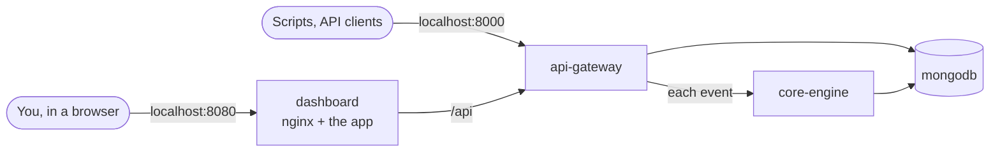

# Running UTDRS with Docker

This guide runs the whole system on one machine with Docker Compose: MongoDB, the core engine, the API gateway and the dashboard, connected and ready to use, with optional demo data. It covers everyday commands, configuration, the optional services, backups, testing and troubleshooting.

Everything here is defined in [`docker-compose.yml`](../docker-compose.yml) at the root of the repository, and CI runs this exact setup on every pull request: it builds the stack, seeds it and drives the dashboard in a browser.

## Contents

1. [What you get](#what-you-get)
2. [Requirements](#requirements)
3. [Quick start](#quick-start)
4. [Everyday commands](#everyday-commands)
5. [Configuration](#configuration)
6. [Optional services](#optional-services)
7. [How the containers are wired](#how-the-containers-are-wired)
8. [Your data: inspect, back up, restore, reset](#your-data-inspect-back-up-restore-reset)
9. [Developing with Docker](#developing-with-docker)
10. [Running the tests against the containers](#running-the-tests-against-the-containers)
11. [Troubleshooting](#troubleshooting)
12. [Beyond your laptop](#beyond-your-laptop)

## What you get



| Container | What it is | On your machine |
|---|---|---|
| `dashboard` | The web app, served by nginx, which also proxies `/api` to the gateway | http://localhost:8080 |
| `api-gateway` | The public API, with interactive docs | http://localhost:8000/api/v1/docs |
| `core-engine` | Detection; only the gateway calls it | not published |
| `mongodb` | MongoDB 7, with its data in the `utdrs_mongo-data` volume | not published |
| `seed` *(on demand)* | Fills the stack with a day of demo activity | |
| `data-processor` *(profile `pipeline`)* | The batch worker | http://localhost:5000/health |
| `scanner-server` *(profile `scanner`)* | The device scanner's collection server (prototype) | localhost:8443 (TLS) |

By default, ports listen on `127.0.0.1` only, so nothing is reachable from other machines.

## Requirements

- **Docker** with **Compose v2.20 or later**: Docker Desktop on macOS or Windows, or Docker Engine with the Compose plugin on Linux. Check with `docker compose version`.
- **About 4 GB of free memory and 4 GB of disk** for the images, builds and data.
- **Free ports 8080 and 8000** (both can be changed; see [Configuration](#configuration)).
- **Git**, to get the code.
- **Windows**: Docker Desktop with the WSL 2 backend. Run the commands in PowerShell, or in a WSL terminal for the Linux versions.
- **Apple Silicon and other ARM machines** work: every image used is multi-architecture.

You do not need Python, Node.js or MongoDB installed: everything builds and runs in containers.

## Quick start

### 1. Get the code

```bash
git clone https://github.com/Alex-Muhscience/UTDRS-Capstone-Project.git utdrs
cd utdrs
```

### 2. Create your `.env`

Docker Compose reads its settings from a `.env` file next to `docker-compose.yml`. Start from the example:

```bash
cp .env.example .env            # Windows PowerShell: Copy-Item .env.example .env
```

Then fill in two secrets in `.env`, each a long random value:

- `JWT_SECRET` signs sign-in tokens.
- `INTERNAL_API_TOKEN` is the shared secret between the gateway and the engine.

Generate them with any of these, and paste one value into each line:

```bash
openssl rand -base64 48
python3 -c "import secrets; print(secrets.token_urlsafe(48))"
```

```powershell
# PowerShell 7+
[Convert]::ToBase64String([System.Security.Cryptography.RandomNumberGenerator]::GetBytes(48))
```

Optionally set `DEMO_PASSWORD` too, so the demo account's password is one you know. Avoid `$` in values: Compose treats it as a variable.

`.env` is ignored by Git. Never commit it. If either secret is missing, Compose stops at once and names it.

### 3. Build and start

```bash
docker compose up -d --build --wait
```

The first build downloads the base images and installs dependencies, which takes a few minutes. Later starts take seconds. `--wait` returns once every container reports healthy, and fails if one does not; see [Troubleshooting](#troubleshooting).

Check the result:

```bash
docker compose ps
```

All four services should show `(healthy)`.

### 4. Add demo data (optional)

```bash
docker compose run --rm seed
```

This signs up a `demo` account, then creates six assets, six detection rules, a simulation and a day of events, all through the gateway's API. The events go through the core engine like any others, so the alerts you get (shadow-copy deletion, encoded PowerShell, a DNS lookup of a blocklisted domain, and more) are the engine's real verdicts. Some are then moved through triage so every status appears. The command prints the account's password (your `DEMO_PASSWORD`, or a generated one). Each run adds another batch of demo data.

### 5. Open the dashboard

Go to **http://localhost:8080**. Sign in as `demo`, or choose *Create an analyst account*.

To see detection working end to end, open **Events → Send test event**, keep the *Shadow copies deleted* preset and send it. Within a second or two the event page shows **Threat detected**, linking to a critical alert mapped to MITRE ATT&CK T1490. The *Editor opened* preset comes back clean.

The gateway's interactive API documentation is at **http://localhost:8000/api/v1/docs**.

## Everyday commands

Run these from the repository root.

| To | Run |
|---|---|
| See what is running, and its health | `docker compose ps` |
| Follow all logs | `docker compose logs -f` |
| Follow one service's logs | `docker compose logs -f api-gateway` |
| Stop everything (keeps your data) | `docker compose down` |
| Start again | `docker compose up -d --wait` |
| Restart one service | `docker compose restart core-engine` |
| Rebuild after changing code or pulling updates | `docker compose up -d --build --wait` |
| Rebuild one service | `docker compose up -d --build --wait api-gateway` |
| Open a shell in a container | `docker compose exec api-gateway bash` (the dashboard image has `sh`) |
| Open the MongoDB shell | `docker compose exec mongodb mongosh utdrs` |
| See resource use | `docker stats` |
| Stop and delete all data | `docker compose down -v` |
| Also delete the built images | `docker compose down -v --rmi local` |

After `git pull`, run `docker compose up -d --build --wait` so the images match the code.

## Configuration

Every setting lives in `.env`. Restart with `docker compose up -d --wait` after changing it: Compose recreates only the containers whose settings changed.

| Variable | Default | |
|---|---|---|
| `JWT_SECRET` | required | Signs sign-in tokens. Changing it signs everyone out. |
| `INTERNAL_API_TOKEN` | required | Shared by the gateway and the engine |
| `DEMO_PASSWORD` | generated | Password of the `demo` account the seed creates |
| `BIND_ADDRESS` | `127.0.0.1` | Address the published ports listen on. `0.0.0.0` makes the stack reachable from your network; see the warning below. |
| `DASHBOARD_PORT` | `8080` | |
| `GATEWAY_PORT` | `8000` | |
| `PROCESSOR_PORT` | `5000` | Data processor (profile `pipeline`) |
| `SCANNER_PORT` | `8443` | Scanner server (profile `scanner`) |
| `ACCESS_TOKEN_EXPIRE_MINUTES` | `30` | How long a sign-in lasts |
| `ENABLE_THREAT_INTEL` | `false` | Turns on the engine's threat-intelligence lookups |
| `VIRUSTOTAL_API_KEY`, `ABUSEIPDB_API_KEY`, `OTX_API_KEY` | empty | Keys for those lookups; each provider is used only when its key is set |

Other settings are fixed in `docker-compose.yml`: the database names, the internal URLs and the engine's database being separate from the gateway's. Each service's README lists everything it supports, and you can add any of those under the service's `environment:` in a `docker-compose.override.yml`, which Compose reads automatically (and which you can keep out of Git).

**Opening the stack to your network.** With `BIND_ADDRESS=0.0.0.0`, anyone who can reach your machine can open the dashboard and, since registration is open, create an account. Only do it on a network you trust, and see [Beyond your laptop](#beyond-your-laptop) before going further.

## Optional services

### Data processor (`pipeline`)

```bash
docker compose --profile pipeline up -d --build --wait
curl http://localhost:5000/health
```

It moves documents from `raw_data` to `processed_data` in the `utdrs_pipeline` database and reports its counts on `/health`. Nothing in UTDRS feeds it yet; see [its README](../services/data-processor/README.md). To try it, insert a document:

```bash
docker compose exec mongodb mongosh utdrs_pipeline --eval 'db.raw_data.insertOne({ event: "login", user: "jsmith" })'
```

A few seconds later, the document appears in `processed_data`.

### Device scanner server (`scanner`)

The scanner is a **prototype**: the server runs and enforces mutual TLS, but the agent cannot talk to it yet (see [its README](../scanner/README.md)). To run the server, first create development certificates in `scanner/configs/certs` (git-ignored), in bash or zsh (on Windows, in WSL or Git Bash):

```bash
mkdir -p scanner/configs/certs && cd scanner/configs/certs
openssl req -x509 -newkey rsa:2048 -nodes -keyout ca.key -out ca.crt -days 30 -subj "/CN=UTDRS development CA"
openssl req -newkey rsa:2048 -nodes -keyout server.key -out server.csr -subj "/CN=localhost"
openssl x509 -req -in server.csr -CA ca.crt -CAkey ca.key -CAcreateserial -out server.crt -days 30 \
  -extfile <(printf "subjectAltName=DNS:localhost")
openssl req -newkey rsa:2048 -nodes -keyout agent.key -out agent.csr -subj "/CN=agent-1"
openssl x509 -req -in agent.csr -CA ca.crt -CAkey ca.key -CAcreateserial -out agent.crt -days 30
chmod 644 server.key        # the container runs as a non-root user and must read it
cd ../../..
```

Then start it, and talk to it with the agent's certificate:

```bash
docker compose --profile scanner up -d --build --wait
printf 'SCAN not-json' | openssl s_client -quiet -connect localhost:8443 -servername localhost \
  -cert scanner/configs/certs/agent.crt -key scanner/configs/certs/agent.key -CAfile scanner/configs/certs/ca.crt
```

The server answers `INVALID_JSON`; the scanner README documents its other replies. These certificates are for local testing only. A readable private key is fine on your laptop, but never on a server.

To run everything at once: `docker compose --profile pipeline --profile scanner up -d --build --wait`. To stop services that belong to a profile, include the profile: `docker compose --profile pipeline --profile scanner down`.

## How the containers are wired

- **One private network** (`utdrs_default`). Containers find each other by service name: the gateway reaches the engine at `http://core-engine:8000`, and everything reaches MongoDB at `mongodb:27017`.
- **Only the dashboard and the gateway are published.** The engine and MongoDB are reachable only from inside the network.
- **The dashboard and the API share one origin.** nginx in the dashboard container proxies `/api` to the gateway, so the browser never needs cross-origin access. Port 8000 is published as well, for the API docs, scripts and integrations.
- **Each service has its own database**, all on the one MongoDB server: `utdrs` (gateway), `utdrs_engine` (engine), `utdrs_pipeline` (data processor) and `utdrs_db` (scanner). The gateway and engine store differently shaped documents in collections with the same names, so they must never share one; [architecture.md](architecture.md) explains why.
- **Start-up order** follows health checks: MongoDB, then the engine, then the gateway, then the dashboard. Each waits until the one before is healthy.
- **Restarts**: every long-running service has `restart: unless-stopped`, so it comes back after a crash or a Docker restart, unless you stopped it yourself.
- **Images** are built from each component's `Dockerfile` and named `utdrs-<service>`. The Python services and the scanner run as non-root users; the dashboard runs as nginx's unprivileged user.

## Your data: inspect, back up, restore, reset

All data lives in the `utdrs_mongo-data` volume. It survives `docker compose down` and rebuilds, and is deleted only by `docker compose down -v` (or `docker volume rm utdrs_mongo-data`).

**Look inside**

```bash
docker compose exec mongodb mongosh utdrs --eval 'db.alerts.countDocuments()'
docker compose exec mongodb mongosh utdrs --eval 'db.alerts.find({}, { title: 1, severity: 1, status: 1 }).limit(5)'
```

To use a graphical tool such as MongoDB Compass, publish MongoDB's port in a `docker-compose.override.yml`:

```yaml
services:
  mongodb:
    ports:
      - "127.0.0.1:27017:27017"
```

**Back up and restore** (every database, compressed, in one file)

```bash
docker compose exec -T mongodb mongodump --archive --gzip > utdrs-backup.gz
docker compose exec -T mongodb mongorestore --archive --gzip --drop < utdrs-backup.gz
```

`--drop` replaces each collection with the backup's contents. Keep backups out of the repository.

**Start over with an empty system**

```bash
docker compose down -v
docker compose up -d --wait
```

## Developing with Docker

- **Change a service, see it running**: edit the code, then `docker compose up -d --build --wait <service>`.
- **Work on the dashboard with hot reload** against the containers: keep the stack running, then

  ```bash
  cd frontend && npm install && npm run dev
  ```

  The dev server at http://localhost:5173 proxies `/api` to the gateway's published port 8000.
- **Work on a Python service outside Docker**: stop its container (`docker compose stop api-gateway`) and run it locally, as its README describes. To reach the containerised MongoDB from your machine, publish its port (see above).
- **Change the gateway's API**: regenerate the dashboard's types (`python services/api-gateway/scripts/export_openapi.py`, then `npm run gen:api` in `frontend/`) and rebuild both images.

## Running the tests against the containers

The dashboard's end-to-end tests can drive the running stack:

```bash
cd frontend
npm ci
npx playwright install chromium
E2E_BASE_URL=http://localhost:8080 npx playwright test
```

They register an analyst, send the ransomware test event, wait for the engine's alert, then investigate, assign and resolve it. They also check that a routine event comes back clean. CI runs them against this same Compose setup. The other test suites run outside Docker, as described in the [main README](../README.md#development).

## Troubleshooting

**`required variable JWT_SECRET is missing a value`** (or `INTERNAL_API_TOKEN`). `.env` is missing, is not next to `docker-compose.yml`, or the line is empty. See [step 2](#2-create-your-env).

**`Bind for 127.0.0.1:8080 failed: port is already allocated`.** Something else uses the port. Pick another in `.env` (for example `DASHBOARD_PORT=8081`) and run `docker compose up -d --wait`.

**`dependency failed to start: container … is unhealthy`, or `--wait` fails.** Look at that container's logs: `docker compose logs core-engine` (or the service named). Common causes:
- MongoDB has not finished starting on a slow machine: run `docker compose up -d --wait` again.
- Not enough memory for Docker: raise Docker Desktop's limit to at least 4 GB.

**Pulling images fails with `429 Too Many Requests`.** Docker Hub limits anonymous pulls. Run `docker login` (a free account raises the limit) and try again.

**The build fails while installing packages** (`pip install` or `npm ci` errors, timeouts). The build needs internet access to PyPI and npm. Behind a corporate proxy, pass it to the build: `docker compose build --build-arg HTTPS_PROXY=http://proxy:port`. A proxy that inspects TLS also needs its CA certificate trusted inside the images.

**MongoDB exits at start with `Illegal instruction`.** MongoDB 5 and later need a CPU with AVX, which some older machines and virtual machines lack. In a `docker-compose.override.yml`, set `image: mongo:4.4` for `mongodb`.

**The dashboard shows "Core engine unreachable" or "Analysis failed".** Check `docker compose ps` and `docker compose logs core-engine`. The engine and gateway must have the same `INTERNAL_API_TOKEN`; both read it from `.env`, so recreate them after changing it: `docker compose up -d --wait`.

**Events show "Not analysed".** The gateway has no engine configured. With this Compose file that cannot happen, unless an override removed `CORE_ENGINE_URL`.

**Everyone was signed out.** `JWT_SECRET` changed, or sign-ins expired (30 minutes by default; change `ACCESS_TOKEN_EXPIRE_MINUTES`). Sign in again.

**The dashboard answers `502 Bad Gateway` on `/api`.** The gateway is down or restarting: check `docker compose ps`. If it is healthy and the error persists, `docker compose restart dashboard` makes nginx look the gateway up again.

**`docker compose run --rm seed` fails with `Incorrect username or password`.** The `demo` account exists from an earlier run with another password. Set `DEMO_PASSWORD` in `.env` to that password, or reset the data (`docker compose down -v`).

**The scanner server exits at once.** Its certificates are missing or unreadable: check `docker compose --profile scanner logs scanner-server`, the files in `scanner/configs/certs`, and that `server.key` is readable (`chmod 644`, for local testing only).

**Changes to the code do not show up.** Rebuild: `docker compose up -d --build --wait`. For the dashboard, also reload the page without the cache (Ctrl+Shift+R).

**Something odd after an upgrade.** Rebuild without the cache: `docker compose build --no-cache && docker compose up -d --wait`.

## Beyond your laptop

This Compose file is made for running UTDRS on one machine. To run it for real users:

- **Serve it over HTTPS** behind a reverse proxy or load balancer that terminates TLS, such as Caddy, Traefik or a cloud load balancer, in front of the dashboard container. Sign-in tokens must never travel over plain HTTP.
- **Publish only the dashboard.** Remove the gateway's published port unless integrations need it, and then put it behind the same TLS proxy. Never publish the engine or MongoDB.
- **Manage secrets properly**: generate them per environment, keep them in your platform's secret store, and rotate them. Do not reuse the values from your laptop.
- **Use a managed or secured MongoDB** with authentication, encryption and automatic backups, by pointing `MONGODB_URI` at it in an override. Keep the gateway and engine on separate databases.
- **Decide who can sign up.** Registration is open, and roles are not yet enforced per route (on the [roadmap](../README.md#roadmap)), so do not expose the stack publicly as it is.
- **Set resource limits and log retention** for each container, and monitor the health endpoints: `/api/v1/health` and `/api/v1/health/db` on the gateway, `/health` on the engine.
- **Build images in CI** and push them to a registry, rather than building on the server.
