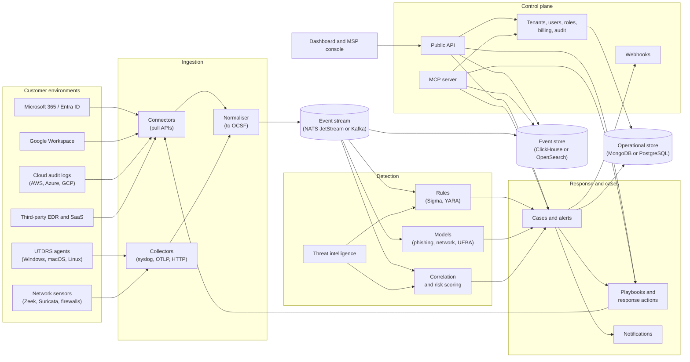

# UTDRS enterprise plan

From a working capstone to a commercial threat detection and response platform: what to build, in what order, why, and every gap between today's code and that product.

This is a working document. Update it as items are finished or decisions change, so that it always describes what is left to do.

## How to use this document

- **Every requirement and gap has an ID** (`FR-ING-03`, `GAP-ENG-07`). Use the ID in branch names, pull requests and issues, so that progress can be traced back here.
- **Priorities:** **P0** blocks the first paying customer; **P1** is needed for a commercial launch; **P2** is needed to win larger customers or to scale; **P3** is a later differentiator.
- **Status:** each gap starts as *open*. When one is closed, mark it *done* with the pull request number rather than deleting it.
- **Baseline:** written on 14 October 2026, against `main` at the merge of pull request #13. [Current state](#3-current-state-the-baseline) records what existed then.
- **Figures in sections 2, 9 and 10 are illustrative.** They show the shape of the business, not forecasts. Replace them with real numbers from customer conversations and pilots as soon as you have them.

## Contents

1. [Summary](#1-summary)
2. [Market, customers and business model](#2-market-customers-and-business-model)
3. [Current state: the baseline](#3-current-state-the-baseline)
4. [Target architecture](#4-target-architecture)
5. [Functional requirements](#5-functional-requirements)
6. [Non-functional requirements](#6-non-functional-requirements)
7. [Public API, MCP server and integrations](#7-public-api-mcp-server-and-integrations)
8. [Gap analysis](#8-gap-analysis)
9. [Roadmap](#9-roadmap)
10. [Team, cost and funding](#10-team-cost-and-funding)
11. [Measures of success](#11-measures-of-success)
12. [Risks](#12-risks)
13. [Decisions to make](#13-decisions-to-make)

---

## 1. Summary

**The product.** UTDRS becomes a hosted security service for small and medium-sized organisations and the IT providers who look after them. It connects to where their risk actually lives (email and identity in Microsoft 365 or Google Workspace, laptops and servers, the network edge), detects attacks with rules and trained models, **responds automatically** to the clear-cut ones, and hands the rest to a person with the evidence already gathered. Everything it does is available through a public API and an **MCP server**, so it can be driven by other systems and by AI assistants.

**Why it can win.** Small organisations cannot staff a security team, and the large platforms are built for organisations that can. The opening is a product that does the work rather than producing alerts for someone to work through, priced and sold for that market, often through the IT providers small organisations already pay.

**The central change from today.** The current system detects and shows. The product must **connect, detect, respond and report** with almost no human effort, for many customers at once, securely enough to be trusted with their data.

**What it takes.** Roughly 18 to 24 months of focused work by a small team, in five phases ([section 9](#9-roadmap)). The first six months are about hardening the foundations and proving value with a handful of pilot customers on one narrow problem: email and account compromise. Revenue follows proof, not features.

---

## 2. Market, customers and business model

### 2.1 Who it is for

| | Who | What they need | How they buy |
|---|---|---|---|
| **Primary customer** | Organisations of 10 to 500 people with no dedicated security staff: professional services, clinics, schools, NGOs, retail, light manufacturing, fintech start-ups | Not to be breached; to meet a regulator's, insurer's or client's demands; to know what to do when something happens | Through their IT provider, or directly by an owner or IT manager, monthly, by card or invoice |
| **Primary channel** | Managed service providers (MSPs) and IT consultancies with 10 to 500 client organisations each | One console for all their clients, automation so they can serve more clients with the same staff, a product they can resell at a margin | Monthly per client or per seat, with volume tiers |
| **Later** | Mid-market organisations (500 to 5,000 people) with a small security team | A cheaper alternative to an enterprise SIEM and SOAR, with good automation | Annual contracts, procurement, security questionnaires |

### 2.2 The problem to solve first

Most small-organisation breaches start with **phishing, stolen credentials and business email compromise**. That is where to start ([decision D1](#13-decisions-to-make)):

1. Watch mailboxes and sign-ins in Microsoft 365 and Google Workspace.
2. Catch phishing (the phishing model is the start), suspicious sign-ins, impossible travel, malicious inbox rules and mass forwarding.
3. Respond automatically: quarantine the message, revoke sessions, force a password reset, disable the account, notify the user and the IT provider.
4. Report: monthly summaries that a manager, an insurer or a regulator can read.

Device inventory (the scanner), network detection (the network model) and endpoint telemetry follow as the second and third modules.

### 2.3 Competition

| Competitor | What they are | Where UTDRS must be better |
|---|---|---|
| Microsoft Defender for Business, Defender for Office 365 | Bundled with Microsoft 365 Business Premium | Works across Microsoft and Google; does the response for the customer; plain-language reports; one console for an MSP's many clients |
| Huntress | Managed detection and response for SMBs, sold through MSPs | Price; email and identity first; open API and MCP; regional presence and data residency |
| Blumira | SIEM with automated response for SMBs | Simplicity of onboarding; built-in email protection; MSP features |
| Wazuh, Security Onion | Free, open-source SIEM and XDR | Hosted, zero maintenance, automated response, support |
| CrowdStrike Falcon Go, SentinelOne | Endpoint protection | Integrate with them rather than compete: ingest their alerts |

**Differentiators to build and defend:** automatic response by default; a console built for MSPs; an open API and MCP server; regional data residency and local compliance reporting; price.

### 2.4 Business model (illustrative)

| Plan | For | What it includes | Indicative price |
|---|---|---|---|
| **Essentials** | Small organisations, direct or via an MSP | Email and identity protection, automatic response, monthly report | about $4 per user per month |
| **Business** | Growing organisations | Essentials plus devices (agent and scanner), network detection, integrations, 1-year retention | about $8 per user per month |
| **Managed** | Organisations that want people too | Business plus 24/7 monitoring by an analyst team (yours or a partner's) | about $15 to $25 per user per month |
| **MSP** | IT providers | Any plan at wholesale, multi-client console, white-label reports | 30 to 40% below list, volume tiers |
| **API and MCP** | Platforms and AI products | Metered access to detections and enrichment | Per call or per protected user |

**The arithmetic of "multi-million":** at a blended $6 per user per month, $1M in annual recurring revenue (ARR) is about 14,000 protected users: for example 30 MSPs averaging 15 clients of 30 users each. $10M ARR is about 140,000 users. The path there is through MSPs, because each one brings many clients.

---

## 3. Current state: the baseline

What exists on `main` today, and how well it works. Sections 5 and 8 build on this.

| Component | Path | Size | State |
|---|---|---|---|
| Dashboard | `frontend/` | ~5,400 lines TS | React 19, TypeScript, Vite, Tailwind. Overview, alerts with triage, events, assets, rules, simulations, users, profile. Polls every 15 s. Typed against the gateway's OpenAPI schema. Unit and Playwright tests. |
| API gateway | `services/api-gateway/` | ~6,800 lines Python | FastAPI, MongoDB. ~70 routes: auth, users and roles, events, alerts, assets, detection rules, simulations, device scans. JWT sessions; internal token for services. |
| Core engine | `services/core-engine/` | ~8,100 lines Python | Six detectors (signature, YARA, correlation, threat intelligence, ML, anomaly), MITRE ATT&CK mapping, risk scoring. Two trained models: phishing email (98.3% accuracy on held-out test), network flows (UNSW-NB15; 0.65% false alarms, 80% of attacks caught at its threshold). |
| Data processor | `services/data-processor/` | ~400 lines Python | Delivers stored device scans to the gateway, with retries and a dead-letter collection. |
| Device scanner | `scanner/` | ~2,100 lines C | Agent collects host inventory and sends it over mutual TLS; server stores it. Linux works; Windows untested. |
| Research | `research/capstone/models/` | | Original models (unusable as saved) and the scripts that trained the engine's versions. |
| Delivery | `docker-compose.yml`, `.github/workflows/ci.yml` | | One-command local stack. CI: unit, service, contract, system, Playwright and Compose tests on every pull request. |

**Working end to end:** an event posted to the gateway is analysed by the engine and becomes an alert an analyst can triage; a device's scan becomes an asset, and an event when it is new or has changed; emails are classified by the phishing model; network flows with the right fields are classified by the network model.

**Not there at all** (from a search of the code): multi-tenancy, audit logging, real-time push, webhooks, notifications (email, chat, SMS), automated response, API keys, single sign-on, multi-factor authentication, data retention, encryption at rest beyond MongoDB's own, service metrics and tracing, a message queue, Sigma rules, STIX/TAXII threat-intelligence feeds, connectors to any external system, and an MCP server.

---

## 4. Target architecture

### 4.1 Overview

### 4.2 What changes from today, and why

| Today | Target | Why |
|---|---|---|
| Events posted one at a time to the gateway, which calls the engine per event | Events flow through a **stream** (NATS JetStream recommended to start; Kafka or Redpanda at large scale); detection consumes it | Back-pressure, replay after outages, many detection workers, no lost events when a service is down |
| Free-form event documents | One schema: **OCSF** (Open Cybersecurity Schema Framework) | Rules and models written once work for every source; standard for exchanging with other tools |
| MongoDB holds events, alerts and everything else | **Event store** for high-volume telemetry (ClickHouse recommended: cheap, fast for search and aggregation), **operational store** for tenants, users, cases, configuration | Telemetry grows to billions of rows; MongoDB is fine for the operational data but costly and slow for searching months of events |
| Detection rules in two places that do not sync | One **rule service**: rules authored in the dashboard or as code (Sigma), versioned, tested, deployed to detection | Analysts' edits must take effect; rules must be reviewable |
| No response | **Response service** with playbooks and actions through connectors, with approvals and undo | Response is the product's main value for customers without staff |
| One organisation | **Multi-tenant** control plane: every record carries a tenant, every query is scoped, MSPs see many tenants | Required to sell as a service and through MSPs |
| Session JWT only | **Identity**: SSO (OIDC, SAML), MFA, API keys, OAuth 2.0 client credentials for machines and MCP | Enterprise buyers and integrations require it |
| Polling dashboard | **Push** (server-sent events or WebSocket) plus webhooks | Responsiveness; integrations |
| Docker Compose | **Kubernetes** (Helm charts) for the hosted service; Compose kept for development and small self-hosting | Scale, rolling updates, isolation |

### 4.3 Services in the target system

| Service | Responsibility | Grows out of |
|---|---|---|
| `api` | Public REST API, authentication, tenancy, rate limits, webhooks | `services/api-gateway` |
| `mcp` | MCP server exposing tools, resources and prompts over the public API | new |
| `ingest` | Collectors (HTTP, syslog, OTLP) and connectors (Microsoft Graph, Google, cloud, EDR); normalisation to OCSF | new; `services/data-processor` becomes part of it |
| `detect` | Rule, model, correlation and threat-intelligence detection on the stream | `services/core-engine` |
| `respond` | Playbooks, response actions, approvals, undo | new |
| `cases` | Alerts, grouping into cases, assignment, notes, evidence, SLAs | alert code in `services/api-gateway` |
| `notify` | Email, Slack, Teams, SMS, push | new |
| `reports` | Scheduled and on-demand reports, compliance mappings | new |
| `agent` | Endpoint agent: inventory, logs, response actions | `scanner/` agent |
| `sensor` | Packaged network sensor (Zeek and Suricata with UTDRS configuration) | new |
| `web` | Dashboard and MSP console | `frontend/` |

---

## 5. Functional requirements

Each requirement: ID, priority, phase (see [section 9](#9-roadmap)), and its relation to today's code.

### 5.1 Tenancy and accounts (TEN)

| ID | Requirement | Priority | Phase |
|---|---|---|---|
| FR-TEN-01 | Every record belongs to a tenant; every API call and query is scoped to the caller's tenants; no cross-tenant access is possible, enforced in one place and tested | P0 | 1 |
| FR-TEN-02 | Organisation sign-up, with a first administrator and email verification | P0 | 1 |
| FR-TEN-03 | MSP accounts that own and switch between many client tenants, with per-client and all-client views | P1 | 2 |
| FR-TEN-04 | Roles: owner, administrator, analyst, read-only, MSP technician, MSP administrator; custom roles with fine-grained permissions | P1 | 2 |
| FR-TEN-05 | Single sign-on with OIDC (Entra ID, Google, Okta) and SAML; SCIM user provisioning | P1 | 2 |
| FR-TEN-06 | Multi-factor authentication (TOTP, WebAuthn passkeys); enforceable per tenant | P0 | 1 |
| FR-TEN-07 | Sessions: short-lived access tokens with refresh, revocation, idle timeout, list and end active sessions | P0 | 1 |
| FR-TEN-08 | Audit log of every change and every response action, by whom, when, from where; exportable; tamper-evident | P0 | 1 |
| FR-TEN-09 | Data residency: choose the region a tenant's data is stored in | P2 | 3 |
| FR-TEN-10 | Tenant deletion and export of all its data | P1 | 2 |

### 5.2 Ingestion and connectors (ING)

| ID | Requirement | Priority | Phase |
|---|---|---|---|
| FR-ING-01 | Common event schema (OCSF) with versioning; every source is normalised to it; raw event kept alongside | P0 | 1 |
| FR-ING-02 | Microsoft 365 connector: Entra ID sign-ins and audit logs, Exchange Online message trace and mailbox audit, Defender alerts (Microsoft Graph and Office 365 Management Activity API), with OAuth admin consent | P0 | 1 |
| FR-ING-03 | Google Workspace connector: login, admin, Gmail and Drive audit (Reports API) | P1 | 2 |
| FR-ING-04 | Email content access for phishing analysis: messages delivered to mailboxes, with headers, links and attachment hashes (Graph and Gmail APIs) | P0 | 1 |
| FR-ING-05 | HTTP ingestion API with API keys, batching, compression and idempotency | P0 | 1 |
| FR-ING-06 | Syslog (RFC 5424, CEF, LEEF) collector for firewalls and network devices | P1 | 2 |
| FR-ING-07 | OpenTelemetry (OTLP) logs receiver | P2 | 3 |
| FR-ING-08 | Network sensor package: Zeek (connection logs mapped to the network model's 21 features) and Suricata EVE JSON | P1 | 2 |
| FR-ING-09 | Cloud audit connectors: AWS CloudTrail and GuardDuty, Azure Activity, GCP Audit Logs | P2 | 3 |
| FR-ING-10 | Third-party EDR alerts: Microsoft Defender for Endpoint, CrowdStrike, SentinelOne | P2 | 3 |
| FR-ING-11 | Connector health: last data received, errors, credential expiry, shown to the customer and alerted on | P0 | 1 |
| FR-ING-12 | Back-pressure, retries and replay; no event lost when a downstream service is unavailable | P0 | 1 |
| FR-ING-13 | Enrichment at ingest: GeoIP, ASN, asset and user lookup, threat-intelligence match | P1 | 2 |
| FR-ING-14 | Per-tenant volume metering for billing and fair use | P1 | 2 |

### 5.3 Endpoint agent and device inventory (AGT)

| ID | Requirement | Priority | Phase |
|---|---|---|---|
| FR-AGT-01 | Agent for Windows, macOS and Linux, signed installers (MSI, PKG, DEB, RPM), silent install for MSP tools (RMM) | P1 | 2 |
| FR-AGT-02 | Enrolment with a tenant token, issuing a per-device certificate; no shared certificates | P1 | 2 |
| FR-AGT-03 | Inventory: hardware, OS and patch level, installed software, users, network interfaces, disk encryption, firewall and antivirus status | P1 | 2 |
| FR-AGT-04 | Telemetry: Windows event logs (security, Sysmon), process starts, logons, persistence changes; Linux auditd/journald; macOS unified log | P2 | 3 |
| FR-AGT-05 | Response actions: isolate from the network, kill a process, delete or quarantine a file, collect a triage package | P2 | 3 |
| FR-AGT-06 | Self-update, health heartbeat, tamper protection, low resource use (under 1% CPU, under 100 MB memory typical) | P1 | 2 |
| FR-AGT-07 | Vulnerability matching of installed software against CVE data | P2 | 3 |

### 5.4 Detection (DET)

| ID | Requirement | Priority | Phase |
|---|---|---|---|
| FR-DET-01 | Stream detection: every event evaluated within seconds, horizontally scalable workers | P0 | 1 |
| FR-DET-02 | Rule service: one store of rules per tenant plus a global library, versioned, with test cases, enable/disable, and changes taking effect within a minute | P0 | 1 |
| FR-DET-03 | Sigma rule support (import, convert to the engine's form, test) | P1 | 2 |
| FR-DET-04 | Detection library for email and identity: phishing, business email compromise, malicious inbox rules, mass forwarding, impossible travel, MFA fatigue, password spraying, OAuth consent phishing, risky sign-ins | P0 | 1 |
| FR-DET-05 | Phishing model v2: trained on current, multilingual phishing; uses headers, sender reputation, URLs and attachments, not only text; evaluated per language | P0 | 1 |
| FR-DET-06 | User and entity behaviour analytics (UEBA): per-user baselines for sign-in times, locations, devices, data volumes | P1 | 2 |
| FR-DET-07 | Network detection: network model retrained on modern and customer-like traffic; Suricata signatures; DNS and TLS anomalies | P2 | 3 |
| FR-DET-08 | Correlation across sources into incidents (for example, phishing email, then sign-in from a new country, then inbox rule) | P1 | 2 |
| FR-DET-09 | Threat intelligence: STIX/TAXII and MISP feeds, abuse.ch, OTX; indicator matching with expiry and confidence | P1 | 2 |
| FR-DET-10 | Detection tuning: suppressions and allow-lists per tenant, feedback from analysts' verdicts used to tune rules and retrain models | P0 | 1 |
| FR-DET-11 | MITRE ATT&CK coverage view: which techniques are covered, by which rules, for which data sources | P1 | 2 |
| FR-DET-12 | Model operations: model registry, versioning, shadow evaluation before promotion, drift monitoring, per-tenant false-positive tracking | P1 | 2 |
| FR-DET-13 | Detection-as-code repository with CI tests against recorded attack data | P1 | 2 |

### 5.5 Alerts, cases and investigation (CAS)

| ID | Requirement | Priority | Phase |
|---|---|---|---|
| FR-CAS-01 | Alerts grouped into cases (incidents) by entity and time; deduplication | P0 | 1 |
| FR-CAS-02 | Case workflow: status, owner, priority, SLA timers, notes, attachments, timeline | P0 | 1 |
| FR-CAS-03 | Evidence view: the events behind an alert, the entities involved (user, device, IP, message), their history | P0 | 1 |
| FR-CAS-04 | Plain-language explanation of every alert: what happened, why it matters, what was done, what to do next | P0 | 1 |
| FR-CAS-05 | Event search across all retained data with a query language, saved searches and time ranges | P1 | 2 |
| FR-CAS-06 | AI investigation assistant: summarise a case, propose next steps, draft the customer message; grounded in the case's data, with citations | P2 | 3 |
| FR-CAS-07 | Export to ticketing (Jira, ServiceNow, Autotask, ConnectWise, HaloPSA) with two-way status sync | P1 | 2 |

### 5.6 Response and automation (RSP)

| ID | Requirement | Priority | Phase |
|---|---|---|---|
| FR-RSP-01 | Response actions through connectors: quarantine or delete an email for all recipients, revoke a user's sessions, force password reset, disable an account, remove an inbox rule, block a sender or domain | P0 | 1 |
| FR-RSP-02 | Playbooks: triggers (detection, severity, entity), conditions, ordered actions, approval steps, notifications; built-in playbooks for the top threats | P0 | 1 |
| FR-RSP-03 | Response modes per tenant and per playbook: automatic, needs approval, notify only | P0 | 1 |
| FR-RSP-04 | Every action recorded in the audit log with its result; every action that can be undone has an undo | P0 | 1 |
| FR-RSP-05 | Endpoint actions through the agent (isolate, kill, quarantine file) | P2 | 3 |
| FR-RSP-06 | Network actions: block an IP or domain at supported firewalls (via their APIs) and DNS filters | P2 | 3 |
| FR-RSP-07 | Visual playbook editor | P2 | 3 |
| FR-RSP-08 | Safety limits: maximum actions per hour per tenant, never disable the last administrator, protected accounts list | P0 | 1 |

### 5.7 Notifications (NTF)

| ID | Requirement | Priority | Phase |
|---|---|---|---|
| FR-NTF-01 | Email notifications for new cases, actions taken and approvals needed, with per-user preferences | P0 | 1 |
| FR-NTF-02 | Slack and Microsoft Teams, with approve/reject buttons for response actions | P1 | 2 |
| FR-NTF-03 | SMS and voice escalation for critical cases | P2 | 3 |
| FR-NTF-04 | Notify the affected end user (for example, "we removed a phishing email from your inbox") | P1 | 2 |
| FR-NTF-05 | Mobile app or progressive web app with push for approvals | P2 | 3 |

### 5.8 Reporting and compliance (RPT)

| ID | Requirement | Priority | Phase |
|---|---|---|---|
| FR-RPT-01 | Monthly executive report per tenant: threats stopped, actions taken, risks outstanding, trends; PDF and web | P0 | 1 |
| FR-RPT-02 | White-label reports for MSPs (their logo and colours) | P1 | 2 |
| FR-RPT-03 | Security posture score per tenant (MFA coverage, admin count, risky settings, unpatched devices) with recommendations | P1 | 2 |
| FR-RPT-04 | Compliance mappings and evidence exports: ISO 27001, SOC 2, NIST CSF, CIS Controls, Cyber Essentials, and regional data-protection laws | P2 | 3 |
| FR-RPT-05 | Cyber-insurance questionnaire support: answers and evidence generated from the platform's data | P2 | 3 |

### 5.9 Platform and administration (PLT)

| ID | Requirement | Priority | Phase |
|---|---|---|---|
| FR-PLT-01 | Billing: plans, per-seat metering, invoices, card and invoice payment, MSP wholesale billing (Stripe or equivalent) | P1 | 2 |
| FR-PLT-02 | Data retention per plan (for example 90 days hot, 1 year archive), enforced automatically | P0 | 1 |
| FR-PLT-03 | Onboarding wizard: connect Microsoft 365 or Google in minutes, see first results the same day | P0 | 1 |
| FR-PLT-04 | Self-hosted edition (Helm chart and Compose) for customers who cannot use the hosted service | P3 | 4 |
| FR-PLT-05 | Status page and in-product incident notices | P1 | 2 |
| FR-PLT-06 | Internationalisation of the dashboard and reports (English first, then French, Swahili, Arabic, Portuguese as the market requires) | P2 | 3 |

### 5.10 API, MCP and integrations (API)

Detailed in [section 7](#7-public-api-mcp-server-and-integrations).

| ID | Requirement | Priority | Phase |
|---|---|---|---|
| FR-API-01 | Versioned public REST API covering everything the dashboard can do, documented with OpenAPI | P0 | 1 |
| FR-API-02 | API keys and OAuth 2.0 client credentials with scopes, per-tenant | P0 | 1 |
| FR-API-03 | Webhooks with signed payloads, retries and delivery log | P1 | 2 |
| FR-API-04 | MCP server with read tools, guarded response tools and resources | P1 | 2 |
| FR-API-05 | SIEM forwarding: Splunk HEC, Microsoft Sentinel, Elastic, syslog/CEF | P2 | 3 |
| FR-API-06 | SDKs: Python and TypeScript, generated from the OpenAPI schema | P2 | 3 |
| FR-API-07 | Integration marketplace page listing connectors and their status | P3 | 4 |

---

## 6. Non-functional requirements

| ID | Area | Requirement | Phase |
|---|---|---|---|
| NFR-01 | Detection latency | 95% of events evaluated within 30 s of arrival; automatic email quarantine within 2 min of delivery | 1 |
| NFR-02 | Throughput | 1,000 events/s sustained per detection cluster at launch; 50,000 events/s by phase 3, scaling horizontally | 1 → 3 |
| NFR-03 | Availability | 99.9% monthly for API, ingestion and response; no event loss during upgrades or single-node failures | 2 |
| NFR-04 | Durability | Ingested events durable before acknowledgement; backups daily with point-in-time recovery; restore tested quarterly | 1 |
| NFR-05 | Recovery | RPO 15 min, RTO 4 h for the hosted service; documented disaster-recovery runbook | 2 |
| NFR-06 | Tenant isolation | Enforced in the data layer, covered by automated tests; no shared credentials across tenants; per-tenant encryption keys by phase 3 | 1 → 3 |
| NFR-07 | Encryption | TLS 1.2+ everywhere, including between internal services; encryption at rest for all stores and backups; secrets in a vault, never in images or env files in production | 1 |
| NFR-08 | Secure development | Threat model per service, dependency and container scanning in CI, SAST, secret scanning, signed images, SBOM per release, annual third-party penetration test | 1 → 2 |
| NFR-09 | Privacy | Data minimisation (store message metadata and verdicts, not full mail bodies, unless needed and consented); configurable PII masking; DPA template; GDPR and regional-law alignment | 1 |
| NFR-10 | Compliance of the product | SOC 2 Type I in phase 2, Type II in phase 3; ISO 27001 in phase 3 | 2 → 3 |
| NFR-11 | Observability | Structured logs, metrics (Prometheus), traces (OpenTelemetry), dashboards and alerts for every service; per-tenant pipeline health | 1 |
| NFR-12 | Performance of the UI | Pages interactive under 2 s on a mid-range laptop; search results under 5 s for 30 days of a 500-user tenant | 2 |
| NFR-13 | Accessibility | WCAG 2.2 AA for the dashboard | 2 |
| NFR-14 | Cost | Infrastructure cost under 15% of revenue per tenant at scale; storage tiering to keep per-user cost under $0.50/month | 2 |
| NFR-15 | Detection quality | Published targets per detection: precision and recall on test data, false positives per 1,000 users per week; regression tests in CI | 1 |
| NFR-16 | Upgrades | Zero-downtime deploys; backward-compatible API within a major version; 12-month deprecation policy | 2 |

---

## 7. Public API, MCP server and integrations

### 7.1 Public API

**Principles**

- One API for everyone: the dashboard, the MCP server, customers' scripts and partners all use the same versioned API (`/api/v2/...` for the public, tenant-aware version; `/api/v1` kept until clients move).
- **Authentication**: user sessions (OIDC/SAML or password with MFA) for people; **API keys** and **OAuth 2.0 client credentials** for machines; every credential carries **scopes** (for example `alerts:read`, `cases:write`, `response:execute`) and a tenant.
- **Tenancy**: every path is tenant-scoped (`/api/v2/tenants/{tenant_id}/...`), or implied by the credential; MSP credentials may list their tenants.
- **Conventions**: cursor pagination, filtering and sorting parameters; `Idempotency-Key` on every POST that creates or acts; ETags for updates; consistent error bodies (RFC 9457 problem details); rate limits per credential with `RateLimit-*` headers.
- **Contract**: the OpenAPI document is the source of truth; the dashboard's types and the SDKs are generated from it (already done for the dashboard today).

**Resources**

| Resource | Operations | Notes |
|---|---|---|
| `tenants` | list (MSP), get, update settings | |
| `users`, `roles`, `api-keys` | CRUD | Admin scopes |
| `connectors` | list available, connect (OAuth flow), status, disconnect | Health and last data received |
| `events` | ingest (batch), search, get | Search uses the event store |
| `alerts` | list, get, update status, feedback (true/false positive) | Feedback feeds tuning |
| `cases` | list, get, create, update, assign, add note, add evidence, timeline | |
| `entities` | users, devices, IPs, domains, messages: get, history, risk | |
| `assets` | list, get, update, inventory, vulnerabilities | |
| `detections` | rules CRUD, test a rule, coverage (ATT&CK) | |
| `playbooks` | CRUD, enable, run manually | |
| `actions` | list available, execute, get status, undo, approve/reject | `response:execute` scope; audit-logged |
| `indicators` | list, add, expire, search | Threat intelligence |
| `reports` | list, generate, download | |
| `audit-log` | search, export | |
| `webhooks` | CRUD, test, delivery log | |
| `posture` | score, findings, recommendations | |

**Webhooks**: events such as `alert.created`, `case.updated`, `action.completed`, `action.approval_requested`, `connector.unhealthy`; payloads signed with HMAC-SHA256 and a timestamp; retries with exponential back-off for 24 h; delivery log in the dashboard.

### 7.2 MCP server

The MCP server lets AI assistants and agent platforms (Claude, other MCP clients, a customer's own agents) investigate and act through UTDRS, with the same permissions and audit trail as a person.

**Design**

- **Transport**: Streamable HTTP, hosted at `https://mcp.<domain>/`; stdio build for local development.
- **Authentication**: OAuth 2.1 as the MCP authorisation specification describes, with the UTDRS identity service as the authorisation server; tokens carry the user's or client's tenant and scopes. No tool can do more than the credential's scopes allow.
- **Implementation**: a thin service over the public API (no direct database access), so tenancy, rate limits and audit apply unchanged. Python with the official MCP SDK, or TypeScript; generated from the OpenAPI schema where possible.
- **Safety**: tools that change something are marked as such; response actions require an explicit `confirm` argument and, by tenant policy, a human approval in UTDRS before they run; every call is in the audit log with the client's identity; outputs are size-limited and never include secrets.

**Tools**

| Tool | Does | Changes anything? | Scope |
|---|---|---|---|
| `list_alerts` | Alerts by status, severity, time, entity | No | `alerts:read` |
| `get_alert` | One alert with evidence and explanation | No | `alerts:read` |
| `list_cases`, `get_case` | Cases and their timelines | No | `cases:read` |
| `search_events` | Search events with a query and time range | No | `events:read` |
| `get_entity` | A user, device, IP, domain or message with history and risk | No | `entities:read` |
| `lookup_indicator` | Is this IP, domain, URL or hash known bad? | No | `intel:read` |
| `analyse_email` | Run the phishing model and checks on a supplied message | No | `detect:run` |
| `get_posture` | Posture score and top recommendations | No | `posture:read` |
| `get_coverage` | ATT&CK coverage for the tenant | No | `detections:read` |
| `update_case` | Change status, assign, add a note | Yes | `cases:write` |
| `give_feedback` | Mark an alert true or false positive | Yes | `alerts:write` |
| `propose_action` | Propose a response action; creates an approval request | Yes (request only) | `response:propose` |
| `execute_action` | Run an approved or auto-allowed action (quarantine email, revoke sessions, disable account, isolate device) | Yes | `response:execute` |
| `generate_report` | Produce a report for a period | Yes (creates a file) | `reports:write` |

**Resources**: `utdrs://cases/{id}`, `utdrs://alerts/{id}`, `utdrs://assets/{id}`, `utdrs://playbooks/{id}`, `utdrs://reports/{id}` (read-only documents an assistant can attach as context).

**Prompts**: `triage_alert`, `investigate_user`, `summarise_week`, `explain_to_customer`.

### 7.3 Integration with existing systems

| Direction | Systems | How |
|---|---|---|
| In: identity and email | Microsoft 365 / Entra ID, Google Workspace, Okta | Connectors (OAuth admin consent; pull APIs and change notifications) |
| In: endpoints | UTDRS agent; Microsoft Defender, CrowdStrike, SentinelOne | Agent; vendor alert APIs |
| In: network | Zeek, Suricata, firewalls (Fortinet, Palo Alto, pfSense, MikroTik, Sophos) | Sensor package; syslog/CEF collector |
| In: cloud | AWS, Azure, GCP | Connectors to audit-log services |
| In: anything else | Custom apps, other logs | HTTP ingestion API, OTLP, syslog |
| Out: SIEM | Splunk, Microsoft Sentinel, Elastic, QRadar | Forward alerts and events (HEC, Log Analytics API, syslog/CEF) |
| Out: ticketing and PSA | Jira, ServiceNow, Autotask, ConnectWise, HaloPSA | Two-way case sync |
| Out: chat | Slack, Microsoft Teams | Notifications with approval buttons |
| Out: automation | Any system | Webhooks; public API; MCP |
| Out: RMM (MSP tools) | NinjaOne, Datto RMM, N-able | Agent deployment scripts; device sync |

**Embedding in an existing product** (for partners): the public API plus webhooks are enough to run UTDRS invisibly behind another product; an embeddable dashboard (iframe with scoped tokens) and white-labelling are P2.

---

## 8. Gap analysis

What is missing or wrong in today's code against the requirements above. Each gap: ID, what it is (with file references where useful), requirements it blocks, priority. Status is *open* unless marked.

### 8.1 Architecture and platform

| ID | Gap | Blocks | Priority |
|---|---|---|---|
| GAP-ARC-01 | No tenancy anywhere: no tenant field on any document, no scoping in repositories (`services/api-gateway/core/database/repositories/`), no tenant in tokens | FR-TEN-01 and almost everything | P0 |
| GAP-ARC-02 | Events go gateway → engine by synchronous HTTP per event (`core/services/detection_pipeline.py`); no queue, no replay, no back-pressure; an engine outage leaves events unanalysed for good (`metadata.analysis.status = error` with no retry) | FR-ING-12, FR-DET-01 | P0 |
| GAP-ARC-03 | No common event schema; events are free-form dicts mapped ad hoc (`DETECTOR_FIELDS` in `detection_pipeline.py`) | FR-ING-01 | P0 |
| GAP-ARC-04 | MongoDB is the only store, including for high-volume events; the engine's anomaly and correlation detectors query raw event history in MongoDB per event (`anomaly_detector.py`, `correlation_detector.py`), which will not scale | NFR-02, FR-CAS-05 | P1 |
| GAP-ARC-05 | Two copies of detection rules (gateway catalogue and engine rules) that never sync; dashboard edits have no effect on detection **Done (#17): the gateway compiles its rules and sends them to the engine after each change and every minute; logic the engine cannot run yet is kept and marked. Built-in rules are not yet shown in the dashboard.** | FR-DET-02 | P0 |
| GAP-ARC-06 | No real-time push to the dashboard (15 s polling, `frontend/src/lib/constants.ts`) | FR-API-03, UX | P1 |
| GAP-ARC-07 | No background job system for scheduled work (reports, retention, connector polling, model retraining) | FR-PLT-02, FR-RPT-01, FR-ING-02 | P0 |
| GAP-ARC-08 | No production deployment: Compose only, no Kubernetes manifests or Helm chart, no infrastructure-as-code, no environments (staging/production) | NFR-03, NFR-16 | P1 |
| GAP-ARC-09 | Service-to-service traffic is plain HTTP with one shared static token (`INTERNAL_API_TOKEN`); no mTLS, no per-service identity, no rotation | NFR-07 | P1 |

### 8.2 Security of the product itself

| ID | Gap | Blocks | Priority |
|---|---|---|---|
| GAP-SEC-01 | No MFA, no SSO, no SCIM (`api/routes/auth.py` is password + JWT only) | FR-TEN-05, FR-TEN-06 | P0 |
| GAP-SEC-02 | Access tokens are 30-minute HS256 JWTs signed with one shared secret, no refresh tokens, no revocation list beyond deactivation; stored in `sessionStorage` (`frontend/src/auth/session.ts`) | FR-TEN-07 | P0 |
| GAP-SEC-03 | Sign-in is not rate limited (SlowAPI configured, no limits set; see gateway README) **Done (#16): throttled per account and address, and per address.** | NFR-08 | P0 |
| GAP-SEC-04 | No API keys or machine credentials; integrations must use a person's token | FR-API-02, FR-ING-05 | P0 |
| GAP-SEC-05 | No audit log of changes or actions | FR-TEN-08, FR-RSP-04 | P0 |
| GAP-SEC-06 | Secrets come from environment variables and `.env` files; no vault, no rotation | NFR-07 | P1 |
| GAP-SEC-07 | `ALLOWED_HOSTS` defaults to `["*"]` (`services/api-gateway/config.py`); the core engine accepts every request when `INTERNAL_API_TOKEN` is unset (`services/core-engine/api/security.py`) **Partly done (#16): the engine now refuses requests without a configured token; `ALLOWED_HOSTS` is still `*` by default.** | NFR-08 | P1 |
| GAP-SEC-08 | No encryption at rest beyond what the MongoDB deployment provides; no field-level encryption for sensitive data (connector credentials will need it) | NFR-07 | P0 before connectors |
| GAP-SEC-09 | No container image signing, SBOM, SAST or container scanning in CI (GitGuardian secret scanning and npm audit only) | NFR-08 | P1 |
| GAP-SEC-10 | No threat model, security policy for the hosted service, or penetration test | NFR-08, NFR-10 | P1 |
| GAP-SEC-11 | The Compose stack serves HTTP; TLS termination is left to the operator | NFR-07 | P1 |

### 8.3 API gateway (`services/api-gateway`)

| ID | Gap | Blocks | Priority |
|---|---|---|---|
| GAP-API-01 | API is not tenant-aware and not versioned for public use; offset pagination only (`limit`/`skip`); no idempotency keys; error format is ad hoc | FR-API-01 | P0 |
| GAP-API-02 | No webhooks | FR-API-03 | P1 |
| GAP-API-03 | No cases: alerts are standalone; no grouping, SLA, evidence model or timeline | FR-CAS-01 to 03 | P0 |
| GAP-API-04 | No event search beyond simple filters and a regex on description (`event_repository.search_events`) | FR-CAS-05 | P1 |
| GAP-API-05 | Simulations are records only: starting one in the engine is a stub that logs "Would start simulation" (`core/services/simulation_service.py`), and simulation events are stored without detection | Demo and testing value | P2 |
| GAP-API-06 | Asset matching is by exact name with no unique index; two concurrent first scans of one device can create two assets (`asset_repository.record_scan`) **Done (#16): unique index on asset names; racing scans retry.** | Data quality | P1 |
| GAP-API-07 | Scanned assets default to type `workstation`; no device classification | FR-AGT-03 | P2 |
| GAP-API-08 | No metering or billing hooks | FR-ING-14, FR-PLT-01 | P1 |

### 8.4 Core engine (`services/core-engine`)

| ID | Gap | Blocks | Priority |
|---|---|---|---|
| GAP-ENG-01 | Processes one event per HTTP request; not a stream consumer; no horizontal scaling story | FR-DET-01 | P0 |
| GAP-ENG-02 | Returns only the single most specific verdict per event (`engine.py`); other detectors' findings are dropped rather than recorded | FR-CAS-03, FR-DET-08 | P1 |
| GAP-ENG-03 | Malware and user-behaviour ML detectors are hand-written indicator scores (`ml_detector.py`); placeholder pickles in `ml_models/` | FR-DET-06 | P1 |
| GAP-ENG-04 | No Sigma support; rules are the engine's own format | FR-DET-03 | P1 |
| GAP-ENG-05 | Threat intelligence is per-lookup API calls (VirusTotal, AbuseIPDB, OTX) with a file cache; no feeds, no STIX/TAXII, no indicator store | FR-DET-09 | P1 |
| GAP-ENG-06 | No suppressions, allow-lists or analyst feedback loop | FR-DET-10 | P0 |
| GAP-ENG-07 | No model registry, versioning, shadow mode or drift monitoring; models are files in the image | FR-DET-12 | P1 |
| GAP-ENG-08 | No identity or email detections (impossible travel, inbox rules, MFA fatigue, OAuth consent) because no such data arrives | FR-DET-04 | P0 |
| GAP-ENG-09 | Uses `ModelRegistry` that writes placeholder models into the working directory at start-up; read-only containers would fail | NFR-08 | P2 |

### 8.5 Machine learning

| ID | Gap | Blocks | Priority |
|---|---|---|---|
| GAP-ML-01 | Phishing model trained on English email mostly from 2008 or earlier; text only; never evaluated on current phishing or on customers' mail ([model card](../services/core-engine/core/models/ml/phishing_email/MODEL_CARD.md)) | FR-DET-05 | P0 |
| GAP-ML-02 | Network model trained on a 2015 lab dataset (UNSW-NB15); 20% of attacks missed at the chosen threshold; weak on fuzzing, shellcode and worms; no source of flow records in UTDRS yet ([model card](../services/core-engine/core/models/ml/network_threat/MODEL_CARD.md)) | FR-DET-07, FR-ING-08 | P2 |
| GAP-ML-03 | No labelled data pipeline from customers (analyst verdicts, user reports of phishing) for retraining | FR-DET-10, FR-DET-12 | P1 |
| GAP-ML-04 | No evaluation harness in CI that fails a change when detection quality drops | NFR-15 | P1 |
| GAP-ML-05 | No explanation of model verdicts (which words, which features drove a score) | FR-CAS-04 | P1 |

### 8.6 Device scanner and agent (`scanner/`)

| ID | Gap | Blocks | Priority |
|---|---|---|---|
| GAP-AGT-01 | Linux only in practice; Windows code paths are not built or tested in CI; no macOS | FR-AGT-01 | P1 |
| GAP-AGT-02 | Inventory is basic: host name, OS, CPU, memory, IPv4 interfaces and MAC; no software, patches, users, encryption or security-tool status | FR-AGT-03 | P1 |
| GAP-AGT-03 | Certificates are created by hand and shared; no enrolment flow, no per-device identity tied to a tenant, no revocation in practice | FR-AGT-02 | P1 |
| GAP-AGT-04 | No installers, service definitions, self-update or tamper protection | FR-AGT-01, FR-AGT-06 | P1 |
| GAP-AGT-05 | No telemetry beyond inventory, no response actions | FR-AGT-04, FR-AGT-05 | P2 |
| GAP-AGT-06 | The server's rate limiter blocks an address **permanently** after more than 30 requests in a minute (`client->blocked = true` in `src/server/api.c`, never cleared until restart); its client table holds 100 addresses and never frees slots **Done (#16): over-limit addresses wait out the window; quiet addresses free their slot.** | Reliability at scale | P1 |
| GAP-AGT-07 | Server database and collection names are hard-coded (`utdrs_db.scans` in `api.c`), and `configs/server.conf` is not read; logs go to `server.log` in the working directory | Operability | P2 |
| GAP-AGT-08 | Dead or misleading code: `src/agent/auth.c` checks a hard-coded fake fingerprint and is unused; `scripts/monitoring/check_heartbeats.sh` queries a PostgreSQL `agents` table that does not exist; the agent no longer sends heartbeats | Maintainability | P2 |
| GAP-AGT-09 | C codebase with manual memory management for a long-running, network-facing agent; consider Go or Rust for the full agent | FR-AGT-01, NFR-08 | Decision D4 |

### 8.7 Data processor and ingestion (`services/data-processor`)

| ID | Gap | Blocks | Priority |
|---|---|---|---|
| GAP-ING-01 | Only handles device scans; polls MongoDB every few seconds as a queue | FR-ING-12 | P1 |
| GAP-ING-02 | Health server is Flask's development server | NFR-03 | P2 |
| GAP-ING-03 | No connectors at all (Microsoft 365, Google, syslog, cloud, EDR) | FR-ING-02 to 10 | P0 |
| GAP-ING-04 | No enrichment (GeoIP, ASN, asset and user lookup) | FR-ING-13 | P1 |

### 8.8 Dashboard (`frontend/`)

| ID | Gap | Blocks | Priority |
|---|---|---|---|
| GAP-WEB-01 | Single-organisation UI; no tenant switcher or MSP views | FR-TEN-03 | P1 |
| GAP-WEB-02 | No cases, investigation graph, search, playbooks, connectors, response approvals, reports or settings pages | Sections 5.5 to 5.8 | P0/P1 |
| GAP-WEB-03 | No onboarding flow | FR-PLT-03 | P0 |
| GAP-WEB-04 | No MFA, SSO or API-key management screens | FR-TEN-05, FR-TEN-06, FR-API-02 | P0 |
| GAP-WEB-05 | Polling rather than push; no notifications centre | GAP-ARC-06 | P1 |
| GAP-WEB-06 | English only; accessibility not audited | FR-PLT-06, NFR-13 | P2 |

### 8.9 Operations, observability and quality

| ID | Gap | Blocks | Priority |
|---|---|---|---|
| GAP-OPS-01 | No metrics, traces or service dashboards (structured logs only); no alerting on the platform's own health | NFR-11 | P0 |
| GAP-OPS-02 | No automated backups or restore tests (manual `mongodump` steps in `docs/docker.md`) | NFR-04 | P0 |
| GAP-OPS-03 | No data retention or deletion jobs | FR-PLT-02, NFR-09 | P0 |
| GAP-OPS-04 | No load or soak tests; throughput unknown | NFR-02 | P1 |
| GAP-OPS-05 | No staging environment, release process, versioning or changelog per release | NFR-16 | P1 |
| GAP-OPS-06 | No incident response runbooks or on-call for the service itself | NFR-03 | P1 |
| GAP-OPS-07 | No hosting for the current dashboard under the project's control (the Vercel account is inaccessible) | Demos, pilots | P1 |

### 8.10 Business, legal and compliance

| ID | Gap | Blocks | Priority |
|---|---|---|---|
| GAP-BIZ-01 | No customer discovery evidence: which customers, what they pay for today, what would make them switch | Everything commercial | P0 |
| GAP-BIZ-02 | No terms of service, privacy policy, data processing agreement or acceptable use policy | First customer | P0 |
| GAP-BIZ-03 | No company security policies or SOC 2 / ISO 27001 programme | NFR-10, enterprise sales | P1 |
| GAP-BIZ-04 | Microsoft and Google app verification for production API access (publisher verification, security assessment for restricted Gmail scopes) | FR-ING-02 to 04 | P0, long lead time |
| GAP-BIZ-05 | Licence of the repository and of third-party datasets (UNSW-NB15 is free for research; check commercial use, or retrain on data you own) | Commercial use of the network model | P1 |

---

## 9. Roadmap

Five phases. Each lists what is built (requirement and gap IDs) and the conditions for moving on. Durations assume the team in [section 10](#10-team-cost-and-funding); with fewer people, keep the order and stretch the time.

### Phase 0: Foundations and discovery (months 0 to 3)

**Goal:** a codebase ready to become multi-tenant, and evidence of what customers will pay for.

- Customer discovery: 20 to 30 interviews with small organisations and MSPs; pick the wedge and price points (GAP-BIZ-01, D1, D2).
- Hosting under your control for demos (GAP-OPS-07).
- Tenancy in the data model and every repository, with isolation tests (GAP-ARC-01, FR-TEN-01).
- Common event schema (OCSF subset) and a stream between ingestion and detection (GAP-ARC-02, GAP-ARC-03).
- Rule sync: one rule store used by detection (GAP-ARC-05).
- Security basics: MFA, refresh tokens, sign-in rate limiting, API keys, audit log (GAP-SEC-01 to 05).
- Observability, backups, retention jobs (GAP-OPS-01 to 03).
- Start Microsoft publisher verification (GAP-BIZ-04).

**Exit:** two tenants cannot see each other's data (tested); the platform's health is visible on dashboards; 10 organisations have agreed to pilot.

### Phase 1: The wedge, with design partners (months 3 to 6)

**Goal:** prove that UTDRS stops email and account attacks for real organisations with almost no effort from them.

- Microsoft 365 connector and email access (FR-ING-02, FR-ING-04, FR-ING-11).
- Email and identity detections; phishing model v2 (FR-DET-04, FR-DET-05, GAP-ML-01).
- Cases, evidence and plain-language explanations (FR-CAS-01 to 04).
- Response actions and playbooks with automatic, approval and notify modes; safety limits (FR-RSP-01 to 04, FR-RSP-08).
- Email notifications; monthly report; onboarding wizard (FR-NTF-01, FR-RPT-01, FR-PLT-03).
- Feedback loop and suppressions (FR-DET-10).
- Public API v2 basics with API keys (FR-API-01, FR-API-02).
- Terms, privacy policy, DPA (GAP-BIZ-02).

**Exit:** 5 to 10 pilot organisations connected for 60+ days; measured threats caught and false-positive rate within targets ([section 11](#11-measures-of-success)); at least 3 willing to pay.

### Phase 2: Commercial launch (months 6 to 12)

**Goal:** a product MSPs can sell and you can support.

- Google Workspace connector (FR-ING-03).
- MSP console, roles, SSO, SCIM (FR-TEN-03 to 05, GAP-WEB-01).
- Slack and Teams with approvals; end-user notifications (FR-NTF-02, FR-NTF-04).
- Webhooks; MCP server v1 with read tools and guarded actions (FR-API-03, FR-API-04).
- Ticketing and PSA sync (FR-CAS-07).
- Agent v1 for Windows and macOS with enrolment and installers (FR-AGT-01 to 03, FR-AGT-06).
- Correlation into incidents, threat-intelligence feeds, UEBA v1 (FR-DET-06, FR-DET-08, FR-DET-09).
- Event store migration and search (GAP-ARC-04, FR-CAS-05).
- Billing and metering (FR-PLT-01, FR-ING-14).
- Kubernetes deployment, staging, zero-downtime releases (GAP-ARC-08, NFR-16).
- SOC 2 Type I; penetration test (NFR-10, GAP-SEC-10).

**Exit:** 20+ MSPs or 200+ paying organisations; around $250k to $500k ARR; churn under 2% a month; 99.9% availability over a quarter.

### Phase 3: Scale and expand (months 12 to 24)

**Goal:** more of each customer's risk covered, larger customers, lower cost per user.

- Endpoint telemetry and response through the agent (FR-AGT-04, FR-AGT-05, FR-RSP-05).
- Network sensor package; network model retrained on modern traffic (FR-ING-08, FR-DET-07, GAP-ML-02).
- Cloud and EDR connectors; syslog collector (FR-ING-06, FR-ING-09, FR-ING-10).
- Posture score; compliance mappings; insurance questionnaires (FR-RPT-03 to 05).
- AI investigation assistant; MCP response tools broadly available (FR-CAS-06).
- Data residency; per-tenant keys (FR-TEN-09, NFR-06).
- SOC 2 Type II, ISO 27001 (NFR-10).
- SIEM forwarding and SDKs (FR-API-05, FR-API-06).

**Exit:** $2M to $5M ARR; net revenue retention above 110%; gross margin above 70%.

### Phase 4: Platform (month 24 onwards)

- Visual playbook editor; integration marketplace; partner embedding and white-label (FR-RSP-07, FR-API-07).
- Self-hosted edition for regulated customers (FR-PLT-04).
- A managed monitoring service, in-house or with partners.
- New regions and languages.

---

## 10. Team, cost and funding

Illustrative; adjust to where the team is based and to actual salaries.

### 10.1 Team by phase

| Role | Phase 0 to 1 | Phase 2 | Phase 3 |
|---|---|---|---|
| Founder / product and sales | 1 | 1 | 1 |
| Backend and platform engineers | 2 | 4 | 6 |
| Detection engineer / security researcher | 1 | 2 | 3 |
| Machine learning engineer | 0.5 | 1 | 2 |
| Frontend engineer | 1 | 2 | 2 |
| Agent engineer (Windows/macOS) | 0 | 1 to 2 | 2 |
| DevOps / site reliability | 0.5 | 1 | 2 |
| Customer success / MSP partnerships | 0 | 1 to 2 | 4 |
| Security analysts (if offering managed monitoring) | 0 | 0 | 3 to 6 |
| Compliance and security officer (can be fractional) | 0 | 0.5 | 1 |

### 10.2 What it costs (indicative)

| | Phase 0 to 1 (6 months) | Phase 2 (6 months) | Phase 3 (12 months) |
|---|---|---|---|
| People | the largest cost; depends on location | | |
| Cloud infrastructure | $1k to $3k/month | $5k to $15k/month | scales with users; target under 15% of revenue |
| Compliance (SOC 2 audit, tooling, penetration tests) | | $30k to $60k | $40k to $80k/year |
| Legal (contracts, DPA, company) | $5k to $15k | $10k to $20k | |

### 10.3 Funding path

| Stage | When | What it pays for | What you need to show |
|---|---|---|---|
| Grants, accelerators, competitions (use the Mozilla finalist status) | Phase 0 | Discovery, foundations, first hires | A clear problem, the working system, the team |
| Pre-seed | End of phase 1 | Phase 2 team | Pilots with measured results, letters of intent, a credible MSP channel |
| Seed | Phase 2 | Phase 3 | Paying customers, ARR growing month on month, low churn |
| Series A | Phase 3 | Scale | $2M+ ARR, strong retention, efficient growth |

---

## 11. Measures of success

| Area | Measure | Target by end of phase 2 |
|---|---|---|
| Detection | Phishing caught (recall) on customers' reported phishing | ≥ 95% |
| Detection | False positives per 1,000 users per week, after tuning | ≤ 2 |
| Detection | Mean time to detect | ≤ 5 min |
| Response | Mean time to contain (automatic) | ≤ 10 min |
| Response | Share of alerts closed without a human | ≥ 70% |
| Platform | Availability | 99.9% |
| Platform | Infrastructure cost per protected user per month | ≤ $0.50 |
| Customers | Time from sign-up to first value (first threat found or posture report) | same day |
| Business | ARR; net revenue retention; monthly logo churn; payback on acquisition cost | see phase exits |

---

## 12. Risks

| Risk | Likelihood | Impact | Mitigation |
|---|---|---|---|
| Microsoft bundles enough to make the product unnecessary | High | High | Lead with Google and mixed environments, response automation, MSP features and local presence; integrate with Defender rather than compete |
| False positives drive customers away | Medium | High | Notify-only mode first, per-tenant tuning, feedback loop, publish quality metrics |
| An automatic action causes harm (disabling the CEO, deleting real mail) | Medium | High | Safety limits, protected accounts, undo, approval modes, gradual rollout |
| A breach of UTDRS itself | Low to medium | Severe | Security-first engineering, isolation tests, pen tests, SOC 2, bug bounty later |
| Microsoft or Google API access delayed or restricted | Medium | High | Start verification in phase 0; use admin-consented application permissions; keep agent and syslog paths as alternatives |
| Models do not generalise to customers' data | High | Medium | Pilot evaluation before claiming accuracy; retraining pipeline; rules and threat intelligence as a backstop |
| Small team spread too thin across modules | High | High | One wedge until phase 2 exit; say no to everything else |
| Dataset licences restrict commercial use | Medium | Medium | Review licences (GAP-BIZ-05); retrain on owned or licensed data before charging for those features |

---

## 13. Decisions to make

Record each decision here with the date and reasoning when it is made.

| ID | Decision | Options | Recommendation |
|---|---|---|---|
| D1 | First wedge | Email and identity; MSP platform; regional/regulated market | Email and identity for M365 first, sold through MSPs, aimed at the region you know best |
| D2 | Pricing and packaging | Per user; per device; per tenant | Per user per month, with MSP wholesale |
| D3 | Event store | ClickHouse; OpenSearch; keep MongoDB | ClickHouse for events; MongoDB (or PostgreSQL) for operational data |
| D4 | Agent language | Keep C; Go; Rust | Go for the full agent (cross-platform, memory-safe, fast to build); keep the C scanner until replaced |
| D5 | Stream | NATS JetStream; Kafka/Redpanda | NATS JetStream to start (simple to run); revisit at phase 3 scale |
| D6 | Operational database | MongoDB; PostgreSQL | Stay on MongoDB through phase 1 to avoid a rewrite; reassess with tenancy and reporting needs |
| D7 | Hosting | AWS; Azure; GCP; regional cloud | The cloud your first customers' data-residency needs point to; Azure fits Microsoft-centric customers |
| D8 | Managed monitoring | Build an analyst team; partner; none | Partner first, decide in phase 3 |
| D9 | Open source | Closed; open core; fully open | Consider open-sourcing the agent and detection rules to build trust and community; keep the hosted platform commercial |
| D10 | Company and licence | Proprietary; open core; an open-source licence | Choose before the first customer. No licence has been chosen yet, so all rights are reserved |
