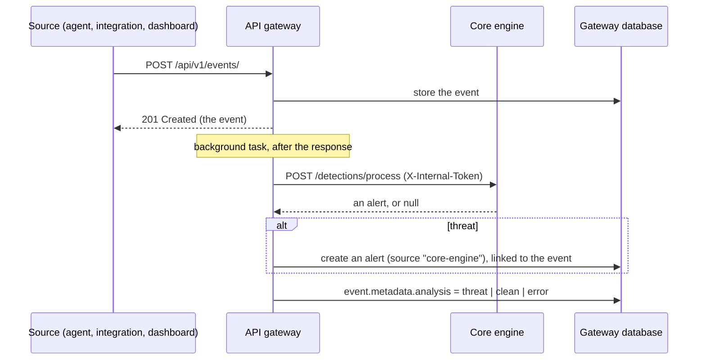

# UTDRS API gateway

The public API of UTDRS, and the only service the dashboard talks to. It authenticates users, stores events, alerts, assets, detection rules and simulations in MongoDB, and hands every new event to the [core engine](../core-engine) for analysis, turning threats into alerts.

Python 3.12 · FastAPI · Pydantic 2 · PyMongo (async) · PyJWT · bcrypt

## How an event becomes an alert



Ingestion never waits for or fails because of the engine: the event is stored and returned first, and analysis runs afterwards. The outcome is recorded on the event as `metadata.analysis`:

| `status` | Meaning | Also recorded |
|---|---|---|
| `threat` | The engine raised an alert | `alert_id` of the new gateway alert |
| `clean` | No detector matched | |
| `error` | The engine could not be reached or failed | `error` |
| *(absent)* | No engine is configured (`CORE_ENGINE_URL` unset) | |

The new alert carries the engine's verdict in `metadata`: `detection_type` (signature, ML, anomaly, …), `core_engine_alert_id`, and `details`, which includes the matched MITRE ATT&CK techniques. Its `event_ids` link back to the event, and its tags come from the detection. The mapping lives in `core/services/detection_pipeline.py`.

## API

All routes are under `/api/v1`. Interactive documentation is served at `/api/v1/docs` and the OpenAPI schema at `/api/v1/openapi.json` (also committed as [`openapi.json`](openapi.json)). Every route except health, login and registration needs `Authorization: Bearer <token>`. Lists return the newest first and take `limit` (up to 500) and `skip`.

| Area | Endpoints |
|---|---|
| Health | `GET /health`, `GET /health/db` |
| Auth | `POST /auth/register`, `POST /auth/login` (form: `username`, `password`), `GET /auth/me`, `PUT /auth/me`, `POST /auth/me/change-password` |
| Alerts | `GET /alerts/` (`status` and `severity` filters combine), `GET /alerts/summary`, `POST /alerts/`, `GET`/`PUT /alerts/{id}`, `PATCH /alerts/{id}/status` (`status`, optional `notes`), `PATCH /alerts/{id}/assign`, `PATCH /alerts/{id}/events/{event_id}`, `POST`/`DELETE /alerts/{id}/tags/{tag}`, `GET /alerts/assigned/{user_id}`, `GET /alerts/search/` |
| Events | `GET /events/` (filters: `event_type`, `asset_id`, `user_id`, `ip_address`), `POST /events/`, `GET`/`PUT /events/{id}`, `GET /events/recent/`, `GET /events/timerange/`, `PATCH /events/{id}/severity`, tags, `GET /events/search/` |
| Assets | `GET /assets/` (filters: `asset_type`, `status`, `criticality`, `department`), `POST /assets/`, `GET`/`PUT /assets/{id}`, lookup by `name`, `ip` or `mac`, `PATCH /assets/{id}/vulnerabilities/add` and `/remove`, `PATCH /assets/{id}/lastseen`, tags, search |
| Detection | `GET /detection/` (rule counts and whether the core engine is reachable), `GET`/`POST /detection/rules`, `GET`/`PUT /detection/rules/{id}`, `PATCH /detection/rules/{id}/status`, by name, tags, metrics, search |
| Simulations | `GET`/`POST /simulation/`, `GET`/`PUT /simulation/{id}`, `POST /simulation/start` and `/stop`, scheduled and running lists, results, linked events and alerts, search |

Allowed values: alert status `open`, `in_progress`, `resolved`, `closed`, `false_positive`; severity `critical`, `high`, `medium`, `low`, `info`; rule status `enabled`, `testing`, `disabled`. Documents are returned with `id`, never MongoDB's `_id`.

`GET /alerts/summary` returns `{ total, by_status, open_by_severity }`, computed with an aggregation, for dashboards that need counts without fetching every alert. `GET /detection/` reports `status` as `active` (engine reachable), `degraded` (configured but unreachable) or `standalone` (no engine configured).

## Accounts and security

- **Registration is open and always creates an active analyst**, whatever role is sent. Users can change their own name, email and password (8 to 72 bytes, bcrypt's limit), but not their role or active flag.
- **Tokens** are HS256 JWTs signed with `JWT_SECRET`, valid for `ACCESS_TOKEN_EXPIRE_MINUTES` (30 by default). Passwords are hashed with bcrypt.
- **Roles are stored but not yet enforced per route**: any signed-in, active user can use every endpoint. Admin-only routes are on the [roadmap](../../README.md#roadmap).
- **Middleware**: a request ID on every response (`X-Request-ID`), security headers (`nosniff`, `DENY` framing, a strict referrer policy, and `Content-Security-Policy: default-src 'self'` except on the docs pages, which need Swagger UI's CDN), a Host header allow-list (`ALLOWED_HOSTS`), a 10 MB request size limit, and a central error handler that does not leak internals.
- **CORS** is limited to `CORS_ORIGINS`. The dashboard does not need it when it is served from the same origin (its dev server, preview server and Docker image all proxy `/api`).
- **Rate limiting**: SlowAPI is set up but no route sets a limit yet. Limiting sign-in attempts needs the client's real address from the proxy in front, and is on the roadmap.
- **The engine is internal**. Calls to it carry `INTERNAL_API_TOKEN` as `X-Internal-Token`; set the same value on both services and do not expose the engine to the internet.

## Configuration

Settings come from the environment or a `.env` file in this directory (see [`.env.example`](.env.example)).

| Variable | Default | |
|---|---|---|
| `MONGODB_URI` | required | MongoDB connection string |
| `DB_NAME` | `utdrs` | The gateway's database. Never the engine's: the two store differently shaped documents in collections with the same names. |
| `JWT_SECRET` | required | Long random secret for signing tokens |
| `JWT_ALGORITHM` | `HS256` | |
| `ACCESS_TOKEN_EXPIRE_MINUTES` | `30` | |
| `CORE_ENGINE_URL` | unset | Base URL of the core engine. Unset: events are stored but not analysed. |
| `CORE_ENGINE_TIMEOUT_SECONDS` | `10` | |
| `INTERNAL_API_TOKEN` | unset | Shared secret for the engine |
| `CORS_ORIGINS` | `["http://localhost:3001","http://localhost:5173"]` | JSON list of browser origins |
| `ALLOWED_HOSTS` | `["*"]` | JSON list of accepted Host headers |
| `API_PREFIX` | `/api/v1` | |
| `DEBUG` | `false` | |

## Run it

```bash
python3.12 -m venv .venv && . .venv/bin/activate
pip install -r requirements-dev.txt
cp .env.example .env        # then set JWT_SECRET (and CORE_ENGINE_URL, INTERNAL_API_TOKEN)
uvicorn app:app --reload --port 8000
```

To run it together with the core engine, already connected, use [`scripts/run-stack.sh`](../../scripts/run-stack.sh) from the repository root.

## Tests

```bash
docker run -d --name utdrs-mongo -p 27017:27017 mongo:7      # once
MONGODB_URI=mongodb://localhost:27017 python -m pytest
```

36 tests. Those that need MongoDB run only when `MONGODB_URI` is set, each run in its own database, dropped afterwards. Without it, the database-free tests still run and the rest are skipped.

- `tests/e2e/test_flows.py`: registration and sign-in, events, alerts (filters, ordering, summary, status errors), assets, rules, role and password rules, response headers. Against a real MongoDB, with no mocks.
- `tests/e2e/test_detection_pipeline.py`: the event-to-alert pipeline against a fake engine (`httpx.MockTransport`), including an unreachable engine and the detection status.
- `tests/unit`: auth and alert routes with mocked repositories, and health. `tests/integration`: the ASGI app over HTTP (health, authentication required).

The [system test](../../tests/system) runs the gateway and the real core engine side by side.

## API schema and the dashboard

The dashboard's TypeScript types are generated from this service's OpenAPI schema. After changing a route or model:

```bash
python scripts/export_openapi.py              # writes openapi.json
cd ../../frontend && npm run gen:api          # regenerates src/api/schema.d.ts
```

Commit both files. CI regenerates them and fails if they differ from what is committed.

## Docker

```bash
docker build -t utdrs-api-gateway .
docker run -p 8000:8000 -e MONGODB_URI=... -e JWT_SECRET=... utdrs-api-gateway
```

Python 3.12 slim, run as a non-root user, served by Gunicorn with four Uvicorn workers on port 8000.

## Layout

```
app.py                 application, middleware, routers
config.py              settings
api/routes/            one module per area
api/middleware/        security headers, request validation, error handling
core/models/           Pydantic models (request, stored and response shapes)
core/database/         connection and one repository per collection
core/services/         business logic, the core engine client and the detection pipeline
utils/                 security (JWT, bcrypt, current user), logging, time
scripts/               export_openapi.py
tests/                 unit, integration and end-to-end tests
```

See [`COPYRIGHT`](COPYRIGHT) for this component's copyright notice and [`SECURITY.md`](SECURITY.md) for security scanning guidance.
