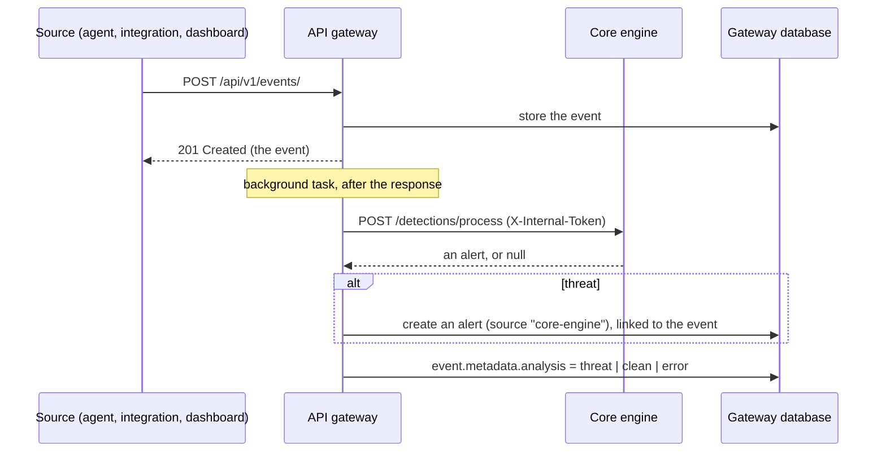

# UTDRS API gateway

The public API of UTDRS, and the only service the dashboard talks to. It authenticates users, stores events, alerts, assets, detection rules and simulations in MongoDB, and hands every new event to the [core engine](../core-engine) for analysis, turning threats into alerts.

Python 3.12 · FastAPI · Pydantic 2 · PyMongo (async) · PyJWT · bcrypt

## How an event becomes an alert



Ingestion never waits for or fails because of the engine: the event is stored and returned first, and analysis runs afterwards. The outcome is recorded on the event as `metadata.analysis`:

| `status` | Meaning | Also recorded |
|---|---|---|
| `threat` | The engine raised an alert | `alert_id` of the new gateway alert |
| `clean` | No detector matched | |
| `error` | The engine could not be reached or failed | `error` |
| *(absent)* | No engine is configured (`CORE_ENGINE_URL` unset) | |

The new alert carries the engine's verdict in `metadata`: `detection_type` (signature, ML, anomaly, …), `core_engine_alert_id`, and `details`, which includes the matched MITRE ATT&CK techniques. Its `event_ids` link back to the event, and its tags come from the detection. The mapping lives in `core/services/detection_pipeline.py`.

## API

All routes are under `/api/v1`. Interactive documentation is served at `/api/v1/docs` and the OpenAPI schema at `/api/v1/openapi.json` (also committed as [`openapi.json`](openapi.json)). Every route except health, login, registration and scans needs `Authorization: Bearer <token>`, where the token is a person's session token or an [API key](#api-keys). Lists return the newest first and take `limit` (up to 500) and `skip`.

| Area | Endpoints |
|---|---|
| Health | `GET /health`, `GET /health/db` |
| Auth | `GET /auth/config` (whether registration is open), `POST /auth/register`, `POST /auth/login` (form: `username`, `password`), `GET /auth/me`, `PUT /auth/me`, `POST /auth/me/change-password` |
| Users | `GET /users/` (filters: `role`, `active`), `GET /users/{id}`; admins only: `POST /users/` (returns a temporary password once), `PATCH /users/{id}` (`role`, `active`), `POST /users/{id}/reset-password` |
| Alerts | `GET /alerts/` (`status` and `severity` filters combine), `GET /alerts/summary`, `POST /alerts/`, `GET`/`PUT /alerts/{id}`, `PATCH /alerts/{id}/status` (`status`, optional `notes`), `PATCH /alerts/{id}/assign`, `PATCH /alerts/{id}/events/{event_id}`, `POST`/`DELETE /alerts/{id}/tags/{tag}`, `GET /alerts/assigned/{user_id}`, `GET /alerts/search/` |
| Events | `GET /events/` (filters: `event_type`, `asset_id`, `user_id`, `ip_address`), `POST /events/`, `GET`/`PUT /events/{id}`, `GET /events/recent/`, `GET /events/timerange/`, `PATCH /events/{id}/severity`, tags, `GET /events/search/` |
| Assets | `GET /assets/` (filters: `asset_type`, `status`, `criticality`, `department`), `POST /assets/`, `GET`/`PUT /assets/{id}`, lookup by `name`, `ip` or `mac`, `PATCH /assets/{id}/vulnerabilities/add` and `/remove`, `PATCH /assets/{id}/lastseen`, tags, search |
| Organisations | `GET /tenants/current`; admins only: `PATCH /tenants/current` (rename) |
| API keys | Admins only: `GET /api-keys/`, `GET /api-keys/scopes`, `POST /api-keys/` (returns the key once), `DELETE /api-keys/{id}` (revoke) |
| Audit log | Admins only: `GET /audit-log/` (filters: `action`, `actor_id`, `target_type`, `target_id`, `since`, `until`), `GET /audit-log/verify` |
| Scans | `POST /scans/`: a device's inventory from the [device scanner](../../scanner), sent by the [data processor](../data-processor) with `X-Internal-Token` instead of a user's token. Creates or updates the asset named after the device, and answers `{ asset_id, new_device, changes, event_id }` |
| Detection | `GET /detection/` (rule counts, whether the core engine is reachable, and the last time the rules were sent to it), `GET`/`POST /detection/rules`, `GET`/`PUT /detection/rules/{id}`, `PATCH /detection/rules/{id}/status`, by name, tags, metrics, search |
| Simulations | `GET`/`POST /simulation/`, `GET`/`PUT /simulation/{id}`, `POST /simulation/start` and `/stop`, scheduled and running lists, results, linked events and alerts, search |

Allowed values: alert status `open`, `in_progress`, `resolved`, `closed`, `false_positive`; severity `critical`, `high`, `medium`, `low`, `info`; rule status `enabled`, `testing`, `disabled`. Documents are returned with `id`, never MongoDB's `_id`.

A scan always refreshes its asset (operating system, address, last-seen time, and the inventory under `metadata.scanner`) and never overwrites the type, criticality, owner or location an analyst has set. Only a device's first scan, or one whose operating system, hardware or network interfaces have changed, raises an event (`event_type: asset_scan`, `source: device-scanner`), which is analysed like any other; `event_id` is null otherwise.

### Detection rules and the core engine

The gateway's rule catalogue is what the core engine runs. A rule's `logic` is a list of comparisons joined by `and`, or by `or`:

```
process_name == 'powershell.exe' and command_line matches '(?i)-enc(odedcommand)?'
event_type == 'authentication' and status in ['failed', 'locked'] and attempts >= 5
```

Comparisons are `==`, `!=`, `>`, `>=`, `<`, `<=`, `in [...]`, `not in [...]`, `matches '<regex>'` (anywhere in the value), `contains`, `startswith`, `endswith` and `<field> exists`; values are quoted strings, numbers, `true`, `false` or lists of those. Fields are `event_type`, `source`, `timestamp`, or anything in the event's data. `core/services/rule_compiler.py` turns this into the engine's conditions.

- **Malformed logic is refused** when a rule is created or edited (422, saying what is wrong).
- **Logic the engine cannot run yet** (counting over a time window with `| count by ...`, functions such as `hour(...)`, comparing with a list such as `threat_intel.domains`, parentheses, or mixing `and` with `or`) is kept in the catalogue but not run. Every rule in a response carries `engine: { runs, reason }`, and the dashboard shows it.
- **Sending:** after every change to a rule, and every `RULE_SYNC_INTERVAL_SECONDS` (60) in case the engine was down or restarted empty, the gateway compiles the enabled rules it can and sends the whole set to the engine's `PUT /rules/managed/gateway`, which replaces the rules it had from the gateway. Testing and disabled rules are not sent. Tags that are ATT&CK technique ids (`T1059.001`) go with the rule as its techniques. `GET /detection/` reports the last attempt as `rule_sync`.
- **Built-in rules** that ship with the engine run alongside these, and are not shown in the catalogue.
- An alert raised by one of these rules names it: `metadata.details.detection.rule_source_id` is the rule's id, and the dashboard links to it.

`GET /alerts/summary` returns `{ total, by_status, open_by_severity }`, computed with an aggregation, for dashboards that need counts without fetching every alert. `GET /detection/` reports `status` as `active` (engine reachable), `degraded` (configured but unreachable) or `standalone` (no engine configured).

## Accounts and security

- **Two roles.** Administrators manage users, detection rules and simulations: every write to `/detection/rules…`, `/simulation/…` and `/users/…` requires the admin role (403 otherwise). Analysts triage alerts and work with events and assets. Everyone signed in can read everything, including the team directory (`GET /users/`), so alerts can show and change who they are assigned to.
- **The first administrator** comes from settings: on every start, `ADMIN_USERNAME` is made an active admin, created with `ADMIN_PASSWORD` if it does not exist. The password is only used at creation. This is also how to restore admin access.
- **Registration** (`ALLOW_REGISTRATION`, on by default) always creates an active analyst, whatever role is sent. With it off, only administrators create accounts, and each new account gets a temporary password, shown once. Administrators can also reset a password to a new temporary one.
- **Account changes take effect at once**: a deactivated account cannot sign in, and its existing tokens are rejected (401). Administrators cannot change their own role or deactivate themselves, so whoever makes a change remains an administrator.
- **Users** can change their own name, email and password (8 to 72 bytes, bcrypt's limit), but not their role or active flag.
- **API keys** let scripts, agents and integrations call the API without a person's password; see [below](#api-keys).
- **Audit log**: sign-ins (succeeded, failed, throttled), registration, profile and password changes, and every change made through the users, alerts, assets, rules, simulations and API key routes are recorded, with who (a person, an API key, or the username tried), from which address, the request ID, what it acted on, the fields sent (never passwords), and whether it went through. Refused attempts are recorded too. Event ingestion is not, as events are their own record. See [below](#audit-log).
- **Tokens** are HS256 JWTs signed with `JWT_SECRET`, valid for `ACCESS_TOKEN_EXPIRE_MINUTES` (30 by default). Passwords are hashed with bcrypt.
- **Middleware**: a request ID on every response (`X-Request-ID`), security headers (`nosniff`, `DENY` framing, a strict referrer policy, and `Content-Security-Policy: default-src 'self'` except on the docs pages, which need Swagger UI's CDN), a Host header allow-list (`ALLOWED_HOSTS`), a 10 MB request size limit, and a central error handler that does not leak internals.
- **CORS** is limited to `CORS_ORIGINS`. The dashboard does not need it when it is served from the same origin (its dev server, preview server and Docker image all proxy `/api`).
- **Sign-in throttling**: after 5 failed attempts in 15 minutes for one account from one address, or 50 from one address across all accounts, sign-in answers 429 with `Retry-After` until the 15 minutes are up. A correct password clears that account's count from that address. Counts are kept in MongoDB (`login_failures`, removed automatically), so every process and replica shares them. Counting by address as well as account stops guessing quickly without letting anyone lock a person out from elsewhere. An unknown username takes as long to reject as a wrong password, so response times do not reveal which accounts exist.
- **Client addresses**: the address a request came from is the connection's, unless the connection comes from one of `TRUSTED_PROXIES`; then `X-Forwarded-For` is read from the right, skipping trusted proxies, so a client cannot choose its own address by sending the header. Docker Compose trusts Docker's private ranges, where the dashboard's nginx runs.
- **Unique asset names**: the gateway creates a unique index on asset names at start-up, so a device's scans always update one asset; renaming an asset to a name in use answers 409. If existing data already has repeated names, the gateway logs a warning and starts without the index.
- **The engine is internal**. Calls to it carry `INTERNAL_API_TOKEN` as `X-Internal-Token`; set the same value on both services and do not expose the engine to the internet.
- **Scans come from UTDRS's own services**. `POST /scans/` accepts only that same `X-Internal-Token`, compared in constant time; a user's token gets 401, and without `INTERNAL_API_TOKEN` configured the route answers 503.

## Organisations

UTDRS keeps each organisation's data apart: a *tenant*. Every user, event, alert, asset, rule, simulation, API key and audit entry belongs to one, and nobody in one organisation can see or change another's, through any route. That is enforced in one place, `core/tenancy.py`, not query by query:

- Authentication sets the caller's organisation for the rest of the request: the user's, or the API key's.
- Collections holding an organisation's data are reached through `ScopedCollection`, which adds the organisation to every filter, update, count and aggregation, stamps it on every document inserted, and refuses to move a document to another organisation. With no organisation set it refuses to run, so a forgotten case fails closed.
- The few places that must look across organisations do so explicitly with `unscoped()`: sign-in, which looks up a username before anyone's organisation is known (usernames and email addresses are unique across organisations), and start-up tasks.
- Each event sent to the core engine carries its organisation, and each organisation's rules are sent separately, so detections never cross organisations either.
- An item from another organisation answers 404, as if it did not exist. Alerts can be assigned only to colleagues. Asset names are unique within an organisation.
- Each organisation has its own audit chain. A sign-in attempt goes to the log of the account it names, or to the platform's for a name nobody has.

**One organisation, or many.** A deployment starts with one, the default (`DEFAULT_TENANT_SLUG`, `DEFAULT_TENANT_NAME`), which the first administrator administers. Data from before tenancy is moved into it at start-up. With `REGISTRATION_MODE=organisation`, registering creates a new organisation with the person as its administrator; with `join` (the default), registering adds an analyst to the default one. Device scans are recorded in `SCANS_TENANT` (default: the default organisation), as the scanner does not yet tie devices to organisations.

**Start-up** tasks (the default organisation, moving old data, indexes, the first administrator) run in every gateway process; a lock in MongoDB (`platform_locks`) makes the processes take turns, so they cannot race.

## API keys

An administrator creates a key on the dashboard's *API keys* page, or with `POST /api-keys/` (`name`, `scopes`, optional `expires_in_days`). The key, `utdrs_<prefix>_<secret>`, is shown once; only its SHA-256 is stored, and the prefix identifies it afterwards. Send it as `Authorization: Bearer <key>`.

- **Scopes** are `<area>:read` (GET) and `<area>:write` (everything else), for `alerts`, `events`, `assets`, `rules` and `simulations`. A route outside a key's scopes answers 403, naming the scope it needs. For example, a firewall forwarder needs only `events:write`, and a SIEM export only `alerts:read`.
- **A key never acts as an administrator**: user administration, rule and simulation changes, API keys and the audit log stay with administrators, whatever the key's scopes. Keys cannot read the team directory.
- **Revoked and expired keys** answer 401 at once. Revoked keys stay listed, with when.
- `last_used_at` is updated at most every five minutes.

## Audit log

Entries are numbered, and each holds the hash of the one before, so `GET /audit-log/verify` (or *Verify the log* on the dashboard) finds an entry that was altered, inserted or removed. A missing number can also mean a write failed part-way: an audit problem is logged and never blocks the action it records. Each entry has `action` (`auth.login_failed`, `rules.update_rule_status`, `api_key.created`, ...), `outcome` (`success`, `denied` or `failed`), `actor`, `address`, `request_id`, `target`, and `details` with the query and fields sent. Filter with `action=rules` for every rule action, or `action=rules.create_rule` for one.

## Configuration

Settings come from the environment or a `.env` file in this directory (see [`.env.example`](.env.example)).

| Variable | Default | |
|---|---|---|
| `MONGODB_URI` | required | MongoDB connection string |
| `DB_NAME` | `utdrs` | The gateway's database. Never the engine's: the two store differently shaped documents in collections with the same names. |
| `JWT_SECRET` | required | Long random secret for signing tokens |
| `ADMIN_USERNAME` | unset | The first administrator; made an active admin on every start |
| `ADMIN_PASSWORD` | unset | Its password, used only when creating it (8 to 72 bytes) |
| `ADMIN_EMAIL` | `<username>@localhost.localdomain` | |
| `ALLOW_REGISTRATION` | `true` | Whether anyone can register |
| `REGISTRATION_MODE` | `join` | `join`: an analyst in the default organisation. `organisation`: a new organisation, with the person as its administrator |
| `DEFAULT_TENANT_SLUG`, `DEFAULT_TENANT_NAME` | `default`, `Default organisation` | The organisation a single-organisation deployment uses |
| `SCANS_TENANT` | unset | The organisation (by slug) device scans are recorded in; unset means the default one |
| `JWT_ALGORITHM` | `HS256` | |
| `ACCESS_TOKEN_EXPIRE_MINUTES` | `30` | |
| `CORE_ENGINE_URL` | unset | Base URL of the core engine. Unset: events are stored but not analysed. |
| `CORE_ENGINE_TIMEOUT_SECONDS` | `10` | |
| `INTERNAL_API_TOKEN` | unset | Shared secret for the engine, and for the data processor delivering scans |
| `RULE_SYNC_INTERVAL_SECONDS` | `60` | How often the rules are re-sent to the engine, besides after each change |
| `CORS_ORIGINS` | `["http://localhost:3001","http://localhost:5173"]` | JSON list of browser origins |
| `ALLOWED_HOSTS` | `["*"]` | JSON list of accepted Host headers. Set it to your domain in production |
| `TRUSTED_PROXIES` | `[]` | JSON list of proxy addresses or networks whose `X-Forwarded-For` is believed |
| `LOGIN_MAX_FAILURES_PER_ACCOUNT` | `5` | Failed sign-ins allowed for one account from one address, per window |
| `LOGIN_MAX_FAILURES_PER_ADDRESS` | `50` | Failed sign-ins allowed from one address across all accounts, per window |
| `LOGIN_FAILURE_WINDOW_SECONDS` | `900` | |
| `API_PREFIX` | `/api/v1` | |
| `DEBUG` | `false` | |

## Run it

```bash
python3.12 -m venv .venv && . .venv/bin/activate
pip install -r requirements-dev.txt
cp .env.example .env        # then set JWT_SECRET and ADMIN_PASSWORD (and CORE_ENGINE_URL, INTERNAL_API_TOKEN)
uvicorn app:app --reload --port 8000
```

To run it together with the core engine, already connected, use [`scripts/run-stack.sh`](../../scripts/run-stack.sh) from the repository root.

## Tests

```bash
docker run -d --name utdrs-mongo -p 27017:27017 mongo:7      # once
MONGODB_URI=mongodb://localhost:27017 python -m pytest
```

111 tests. Those that need MongoDB run only when `MONGODB_URI` is set, each run in its own database, dropped afterwards. Without it, the database-free tests still run and the rest are skipped.

- `tests/e2e/test_flows.py`: registration and sign-in, events, alerts (filters, ordering, summary, status errors), assets, rules, role and password rules, response headers. Against a real MongoDB, with no mocks.
- `tests/e2e/test_users.py`: role checks on rules and simulations, the team directory, account administration (create, role changes, deactivation, password resets), self-lockout protection, closed registration and the startup administrator.
- `tests/e2e/test_detection_pipeline.py`: the event-to-alert pipeline against a fake engine (`httpx.MockTransport`), including an unreachable engine and the detection status.
- `tests/e2e/test_tenancy.py`: two organisations: lists, search, counts, reads and changes of another organisation's users, events, alerts, assets, rules, simulations and API keys refused; names unique per organisation; API keys confined to their organisation; separate audit chains; rules and events sent to the engine per organisation; organisation registration; scoped collections failing closed.
- `tests/e2e/test_api_keys_audit.py`: API keys shown once and stored as hashes; scopes allowing and refusing; keys never acting as administrators; revoked, expired and unknown keys refused; sign-ins and changes audited with who made them (people and keys) and refused attempts recorded; no secrets in the log; tampering found by the chain; concurrent entries forming one chain.
- `tests/e2e/test_hardening.py`: sign-in throttling per account and address and per address, a correct password clearing the count, identical answers for unknown and wrong passwords, client addresses behind trusted proxies, and unique asset names under concurrent scans.
- `tests/e2e/test_rule_sync.py`: rules reaching a fake engine on create, edit, disable and tag changes; rules the engine cannot run kept but not sent; malformed logic refused; the sync status, including failure.
- `tests/unit/test_rule_compiler.py`: the rule language: what compiles to which conditions, what is kept but not run, and what is malformed.
- `tests/e2e/test_scans.py`: device scans: a new device, an unchanged scan, a changed inventory that keeps an analyst's edits, and the internal token.
- `tests/unit`: auth and alert routes with mocked repositories, and health. `tests/integration`: the ASGI app over HTTP (health, authentication required).

The [system test](../../tests/system) runs the gateway and the real core engine side by side.

## API schema and the dashboard

The dashboard's TypeScript types are generated from this service's OpenAPI schema. After changing a route or model:

```bash
python scripts/export_openapi.py              # writes openapi.json
cd ../../frontend && npm run gen:api          # regenerates src/api/schema.d.ts
```

Commit both files. CI regenerates them and fails if they differ from what is committed.

## Docker

```bash
docker build -t utdrs-api-gateway .
docker run -p 8000:8000 -e MONGODB_URI=... -e JWT_SECRET=... utdrs-api-gateway
```

Python 3.12 slim, run as a non-root user, served by Gunicorn with four Uvicorn workers on port 8000.

## Layout

```
app.py                 application, middleware, routers
config.py              settings
api/routes/            one module per area
api/middleware/        security headers, request validation, error handling
core/models/           Pydantic models (request, stored and response shapes)
core/database/         connection and one repository per collection
core/services/         business logic, the core engine client and the detection pipeline
utils/                 security (JWT, bcrypt, current user), logging, time
scripts/               export_openapi.py
tests/                 unit, integration and end-to-end tests
```

See [`COPYRIGHT`](COPYRIGHT) for this component's copyright notice and [`SECURITY.md`](SECURITY.md) for security scanning guidance.
